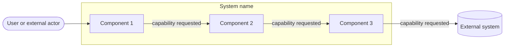
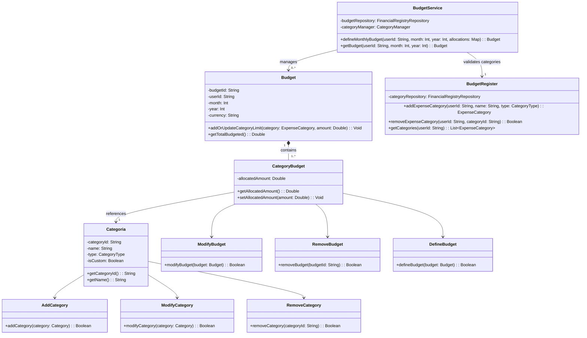

<!--
HOW TO USE THIS TEMPLATE
------------------------
1. Copy this file to docs/design/01_Architectural_and_Detailed_Design.md in your team repository.
2. This is v1.0 of work you already started: your Class 11 "Architectural Hypothesis v0.1"
   and your Class 12 "Detailed Design v0.1". Extend them to your whole system. Do not restart.
3. Use YOUR project. Generic examples (e-commerce, food delivery, banking, library) are
   only reference material and cannot be submitted as project artifacts.
4. Fill in every section. If something genuinely does not apply, write "N/A: reason".
   Never invent content to fill a blank.
5. Every diagram needs the table or argument that explains it. A diagram records design
   decisions. It does not create them.
6. Diagrams: Mermaid is preferred because it renders on GitHub. PlantUML or another tool is
   accepted if the exported image is committed and embedded in this file.
   Optionally, also add a JPG of each diagram in docs/design/diagrams/ (the Markdown prevails if they differ).
7. Read Design_Deliverable_1_Example.md for the expected level of detail. Do not copy it.
-->

# [Project Name] — Architectural & Detailed Design v1.0

| | |
|---|---|
| **Team** | |
| **Members** | |
| **Status** | Draft / Ready for review |
| **Date** | |
| **Inputs** | `docs/requirements/`, Architectural Hypothesis v0.1 (Class 11), Detailed Design v0.1 (Class 12) |

---


## 1. System Overview & Design Drivers

**System purpose** (2–3 sentences, in terms of the need it satisfies)

El sistema busca permitir a los jóvenes colombianos tomar el control de sus finanzas personales mediante la planificación mensual de presupuestos y el registro diario de sus transacciones. Satisface la necesidad de monitorear en tiempo real la ejecución del presupuesto frente a los gastos reales mediante un panel gráfico interactivo y alertas visuales de sobrecosto. Asimismo, garantiza la disponibilidad y sincronización oportuna de los datos en la nube entre dispositivos móviles y computadores, operando exclusivamente en Pesos Colombianos (COP).

**Requirements that shape the structure** *(the ones that most influence the design, not all of them)*

| Requirement / Use Case ID | Why it shapes the structure | Quality attribute, constraint or business rule involved |
|---|---|---|
| **REQ-08 & REQ-10**<br>*(Multiplataforma y Sincronización)* | Define una arquitectura cliente-servidor basada en la nube con servicios API e interfaz Web Responsive, asegurando la sincronización oportuna y la disponibilidad de datos al cambiar entre dispositivos móviles y computadores. | **Atributos de calidad:** Availability, Usability (Responsive UI), Data Synchronization.<br>**Necesidad:** Need-06. |
| **REQ-06**<br>*(Análisis Comparativo y Visualización - Dashboard)* | Exige un componente de procesamiento y agregación de datos en el backend optimizado para calcular en tiempo real las diferencias entre el presupuesto planificado y las transacciones ejecutadas, alimentando el panel gráfico del frontend. | **Atributos de calidad:** Performance (Real-time responsiveness), Usability.<br>**Regla de negocio / Necesidad:** RN-01, Need-05. |
| **REQ-02 & REQ-04**<br>*(Registro de Gastos y Alerta Visual de Sobrecosto)* | Condiciona el modelo de dominio para capturar los atributos obligatorios del gasto y requiere la ejecución de un motor de reglas no bloqueante que genere alertas visuales al superar el límite de una categoría sin impedir la transacción. | **Atributos de calidad:** Data Integrity, Modifiability.<br>**Reglas de negocio:** RN-02 (alerta no bloqueante), RN-05 (tipos de gasto), RN-06 (moneda exclusiva en COP). |
| **REQ-01**<br>*(Gestión de Presupuesto Mensual)* | Establece la entidad principal del modelo de datos para estructurar, editar y consultar el presupuesto mensual del usuario, sirviendo de base para la asignación y distribución del dinero. | **Restricción y Regla de negocio:** RN-01 (único presupuesto mensual), RN-06 (exclusividad en COP).<br>**Necesidad:** Need-01. |
| **REQ-05 & REQ-07**<br>*(Gestión de Cuentas y Categorías Personalizadas)* | Requiere un modelo de datos extensible que combine categorizaciones precargadas por expertos con la libertad del usuario para crear o modificar categorías y medios de pago (incluyendo cuentas bancarias y efectivo). | **Atributo de calidad:** Modifiability / Extensibility.<br>**Reglas de negocio / Necesidades:** RN-04, Need-02, Need-03. |

---

## 2. Architectural Design

*(Outward-facing: what are the major parts, what is each responsible for, how do they interact?)*

### 2.1 System Context & Boundary

| Outside the system | Type (actor / external system / hardware) | How the system interacts with it |
|---|---|---|
| | | |

### 2.2 Components, Responsibilities & Capabilities

Cover the principal functional scope of your whole system.



*(Everything inside `SYS` is what you build and control. Everything outside is what you only interact with. Label each arrow with the capability being requested.)*

| Component | Main responsibility | Requirements / use cases supported | Provided capabilities | Required capabilities | Main dependencies |
|---|---|---|---|---|---|
| | | | | | |

*Checks: is every component named by responsibility, not technology ("the component that persists orders", not "the database")? Does any component exist only to make the diagram look more complex?*

---

## 3. Detailed Design

*(Inward-facing: how is each selected component designed internally?)*

## 3. Detailed Design

### 3.1 Components selected

| Component | Why it was selected (risk, complexity, centrality to the drivers) |
|---|---|
| **Budget Manager** | Core domain logic component responsible for coordinating monthly budget planning, applying budget allocation rules in COP, and enforcing custom/preset category operations (RN-01, RN-04, RN-06). Selected due to its central role in processing domain rules and managing budget life cycles

## 3.2 Class Diagram(s)


--- 

## 3.3 Class Responsibilities

| Class | Component it belongs to | Responsibility | Key collaborators |
|---|---|---|---|
| `BudgetService` | Budget Manager[cite: 5] | Entry point service that coordinates monthly budget creation, delegation of category validation, and retrieval of user budgets[cite: 7]. | `BudgetRegister`, `Budget`, `FinancialRegistryRepository`[cite: 7] |
| `BudgetRegister` | Budget Manager[cite: 5] | Handles category administration, including adding, removing, and retrieving expense categories[cite: 7]. | `FinancialRegistryRepository`, `Categoria`[cite: 7] |
| `Budget` | Budget Manager[cite: 5] | Root domain entity representing a user's monthly budget in COP[cite: 1, 3, 7]. | `CategoryBudget`[cite: 7] |
| `CategoryBudget` | Budget Manager[cite: 5] | Domain entity encapsulating the monetary limit allocated to a specific category within a budget[cite: 1, 7]. | `Budget`, `Categoria`, `DefineBudget`, `ModifyBudget`, `RemoveBudget`[cite: 7] |
| `Categoria` | Budget Manager[cite: 5] | Domain entity representing an expense category with name, type, and custom status (RN-04, RN-05)[cite: 1, 3, 7]. | `CategoryBudget`, `AddCategory`, `ModifyCategory`, `RemoveCategory`[cite: 7] |
| `DefineBudget` | Budget Manager[cite: 5] | Action class executing the creation logic for defining a new budget allocation[cite: 7]. | `CategoryBudget`, `Budget`[cite: 7] |
| `ModifyBudget` | Budget Manager[cite: 5] | Action class executing modifications on existing budget category allocations[cite: 7]. | `CategoryBudget`, `Budget`[cite: 7] |
| `RemoveBudget` | Budget Manager[cite: 5] | Action class executing the deletion or inactivation of a budget record[cite: 7]. | `CategoryBudget`, `Budget`[cite: 7] |
| `AddCategory` | Budget Manager[cite: 5] | Action class executing the registration of a new expense category[cite: 7]. | `Categoria`[cite: 7] |
| `ModifyCategory` | Budget Manager[cite: 5] | Action class executing modifications to an existing expense category[cite: 7]. | `Categoria`[cite: 7] |
| `RemoveCategory` | Budget Manager[cite: 5] | Action class executing the removal of a custom category[cite: 7]. | `Categoria`[cite: 7] |

---

## 3.4 Behavior of one key operation

**Operation:** `BudgetService.define_monthly_budget(user_id, month, year, allocations)`[cite: 7]

```python
def define_monthly_budget(self, user_id: str, month: int, year: int, allocations: dict) -> Budget:
    if not allocations:
        raise ValueError("El presupuesto debe contener al menos una categoría asignada.")
    if not (1 <= month <= 12):
        raise ValueError("El mes especificado debe estar entre 1 y 12.")
    
    budget = Budget(user_id=user_id, month=month, year=year, currency="COP")
    
    for category, amount in allocations.items():
        if amount < 0:
            raise ValueError(f"El monto para la categoría {category.name} no puede ser negativo.")
        budget.add_or_update_category_limit(category, amount)
    
    action = DefineBudget()
    if not action.define_budget(budget):
        raise RuntimeError("Falló la ejecución de la acción al definir el presupuesto.")
    
    return self.budget_repository.save(budget)

---

## 4. Design Quality — Cohesion, Coupling, Information Hiding

| Question | Your answer, with evidence from your design |
|---|---|
| **Cohesion:** do the responsibilities inside each class or component belong together? | |
| **Coupling:** how far does a change in one element spread? Where are the strongest dependencies? | |
| **Information hiding:** what did you keep private or internal, and why? | |

**At least one real finding** (a problem you found in your own design) **and what you changed or would change:**
>

---

## 5. Design Decisions & Decision Record

Two decisions are required: one architectural (Class 11 level) and one detailed-design (Class 12 level). Avoid "it is best practice", "it scales" or "it is cleaner" without project evidence.

### Decision A — Architectural

| | |
|---|---|
| **Context** (requirement, constraint or problem that motivated it) | |
| **Decision** | |
| **Rationale** (why it is reasonable here) | |
| **Trade-off accepted** | |

### Decision B — Detailed design

| | |
|---|---|
| **Context** | |
| **Decision** | |
| **Rationale** | |
| **Trade-off accepted** | |

### ADR

At least one of the two decisions above must also be recorded as an ADR (use `Plantilla_ADR_Nygard`) in `docs/decisions/`.

**ADR file:** `docs/decisions/ADR-XXX-title.md` — records Decision [A / B].

---

## 6. Traceability

| Requirement ID | Use Case | Component(s) | Class(es) |
|---|---|---|---|
| | | | |

*(Every requirement in Section 1 must appear. Every component and class should appear at least once. If an element traces to nothing, ask why it exists.)*

---

## 7. Optional — AI-Assisted Design Reflection

> One design recommendation generated by AI that the team accepted, modified or rejected, and why.

---

## 8. Consistency Checklist

- [ ] Every component in the diagram appears in the responsibilities table, and the other way around.
- [ ] Every class belongs to an identifiable component.
- [ ] Components are named by responsibility, not technology.
- [ ] Nothing inside the system boundary is something you do not control.
- [ ] Provided and required capabilities match across components (what one requires, another provides).
- [ ] Both decisions name a real cost or limitation, and at least one has an ADR.
- [ ] The traceability table has no empty rows and no orphan components or classes.
- [ ] Diagrams render correctly on GitHub (or the exported images are embedded).
