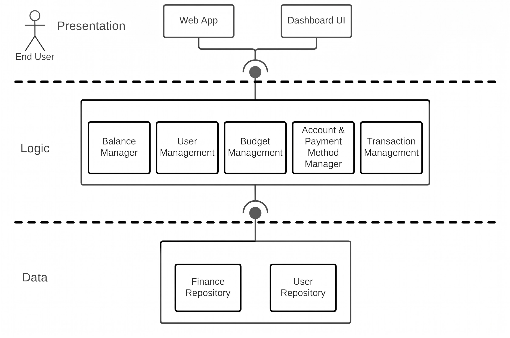
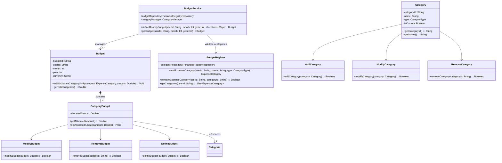

<!--
HOW TO USE THIS TEMPLATE
------------------------
1. Copy this file to docs/design/01_Architectural_and_Detailed_Design.md in your team repository.
2. This is v1.0 of work you already started: your Class 11 "Architectural Hypothesis v0.1"
   and your Class 12 "Detailed Design v0.1". Extend them to your whole system. Do not restart.
3. Use YOUR project. Generic examples (e-commerce, food delivery, banking, library) are
   only reference material and cannot be submitted as project artifacts.
4. Fill in every section. If something genuinely does not apply, write "N/A: reason".
   Never invent content to fill a blank.
5. Every diagram needs the table or argument that explains it. A diagram records design
   decisions. It does not create them.
6. Diagrams: Mermaid is preferred because it renders on GitHub. PlantUML or another tool is
   accepted if the exported image is committed and embedded in this file.
   Optionally, also add a JPG of each diagram in docs/design/diagrams/ (the Markdown prevails if they differ).
7. Read Design_Deliverable_1_Example.md for the expected level of detail. Do not copy it.
-->

# UN-Budget  — Architectural & Detailed Design v1.0

| | |
| --- | --- |
| **Team** | UN-budget | Grupo 5 - Ingesoft I |
| **Members** | David Esteban Sainea Rubio, sabenitez, Kevin Florez, Miguel Angel Guativa Archila, Joger Ivan Munoz Duenas |
| **Status** | Approved |
| **Date** | 19/10/2026 October 19th, 2026 |
| **Inputs** | `docs/requirements/`, Architectural Hypothesis v0.1 (Class 11), Detailed Design v0.1 (Class 12) |

---

## 1. System Overview & Design Drivers

### System purpose

> The system is intended to provide the end user with a digital platform where they will be able to manage their personal finances by tracking expenses against monthly personal budgets, which are divided into several categories. Moreover, the application will create reports for the user to visualize their financial health, so that they can make informed decisions based on their balance.

**Requirements that shape the structure** *(the ones that most influence the design, not all of them)*

| Requirement / Use Case ID | Why it shapes the structure | Quality attribute, constraint or business rule involved |
| --- | --- | --- |
| REQ-01 | It provides the system with the necessary capabilitities for the user to design their budgets. | BR-01: "For an individual to manage their personal finances, it is necessary to design and create a monthly personal budget." |
| REQ-02 | Tracking an expense is fundamental for the user to know their financial habits. | BR-05: "The user's expenses must be classified into one of three main types: needs, wants and savings (including debt payments or investments), regardless of the category each expense belongs to." |
| REQ-03 | Similar to the REQ-02, but regarding to the user's incomes instead of the expenses. | BR-03: "An income transaction can be recorded regardless of whether or not the end user has already received it." |

---

## 2. Architectural Design

### 2.1 System Context & Boundary

| Outside the system | Type | How the system interacts with it |
|---|---|---|
| End User | Actor | Interacts with the application to create their monthly budget, log manual incomes and expenses, configure payment methods, and analyze the comparative dashboard. |

### 2.2 Components, Responsibilities & Capabilities



| Component | Main Responsibility | Requirements / Use Cases Supported | Provided Capabilities | Required Capabilities | Main Dependencies |
| --- | --- | --- | --- | --- | --- |
| Web App | Provides the responsive interface for the user to input financial data from a mobile device or PC. | REQ-01, REQ-02, REQ-03, REQ-04, REQ-05, REQ-07, REQ-08 | User management, transaction registration, and budget configuration interface | UI-to-Logic integration services | Logic Layer |
| Dashboard UI | Presents the interactive visual panel and visually notifies about cost overruns. | REQ, 04 REQ-06 | Comparative budget, balances, and trend visualization interface | Metrics & historical data analysis services | Logic Layer |
| Balance Manager | Cross-references actual data against the budget to calculate deviations and alerts. | REQ-04, REQ-06 | Budget execution calculation and alerts on overruns | Logic-to-Data integration services | Data Layer |
| User Management | Manages user identity to ensure everyone sees only their own finances. | Need-01 | User registration, authentication, and profile updates | Logic-to-Data integration services | Data Layer |
| Budget Management | Applies the rules to create, edit categories, and set monetary limits. | REQ-01, REQ-07 | Creation, categorization, and modification of monthly budgets | Logic-to-Data integration services | Data Layer |
| Account & Payment Method Manager | Administers the creation and modification of money sources (banks or cash). | REQ-05 | Configuration and validation of diverse payment methods and bank accounts | Logic-to-Data integration services | Data Layer |
| Transaction Management | Validates, classifies (Need/Want/Savings), and coordinates the recording of incomes and expenses. | REQ-02, REQ-03, REQ-04 | Logging, classification, and validation of manual and bank transactions | Logic-to-Data integration services | Data Layer |
| Finance Repository | Persists and retrieves budgets, transactions, and accounts, ensuring data integrity. | REQ-11 | Storage, querying, and updating of transactional, account, and budget data | none | none |
| User Repository | Persists and retrieves user credentials and profiles. | Need-01 | Authentication data persistence, user profiles, and session data | none | none |

## 3. Detailed Design

Each component is designed to fulfill the established requirements by clearly defining the responsibility of each class, the process it executes, and the objective it aims to achieve. The design seeks to maintain high cohesion within each module, ensuring that its classes work together in a coordinated manner and share a common purpose. Furthermore, the separation of responsibilities helps maintain an organized, modular, and understandable codebase that is easy to modify and scale, facilitating the addition of new functionalities without significantly affecting the behavior of existing components.

### 3.1 Components selected (at least two)

| Component | Why it was selected (risk, complexity, centrality to the drivers) |
| --- | --- |
| **Transaction & Movement Management** | This component is central to the financial integrity of the system, as it manages the creation, modification, and soft deletion of expenses and income records. It must ensure transaction consistency, preserve the history of changes, and prevent the loss of financial information. Additionally, it must handle expense classification by category and facilitate budget monitoring. It must also distinguish between expected and actual dates, allowing transactions to be scheduled and updated without compromising the reliability of the user's financial information. |
| **Budget Manager** | Core domain logic component responsible for coordinating monthly budget planning, applying budget allocation rules in COP, and enforcing custom/preset category operations (RN-01, RN-04, RN-06). Selected due to its central role in processing domain rules and managing budget life cycles |

## 3.2 Class Diagram(s)

### Transaction & Movement Manager Class Diagram

```mermaid
classDiagram
    direction TB

    class RegisterExpense {
        + registerExpense(expense:Expense) status:ENUM[Success, Rejected, Failed], error:String/None, alert:"Overrun"/None  
    }

    class ModifyExpense {
        + modifyExpense(new_expense:Expense) status:ENUM[Success, Rejected, Failed], error:String/None, alert:"Overrun"/None  
    }

    class RemoveExpense {
        + removeExpense(expense:Expense) status:ENUM[Success, Rejected, Failed], error:String/None
    }

    class Expense {
        +ID: Identificador_DB
        -amountCOP: Integer
        -date: Date
        -payment_method: Paymethod
        -category: Category
        -status: ENUM
        -creation_date: Date
        -last_modified_date: Date
    }

    class Category {
        - category: Category
    }

    class RegisterIncome {
        + registerIncome(income:Income) status:ENUM[ValueError,RuntimeError,Success]
    }

    class ProgramIncome {
        + programIncome(new_date:Date) status:ENUM[ValueError,RuntimeError,Success]
    }

    class ModifyIncome {
        + modifyIncome(modified_income:Income) status:ENUM[ValueError,RuntimeError,Success]
    }

    class RemoveIncome {
        + removeIncome(income:Income) status:ENUM[ValueError,RuntimeError,Success]
    }

    class Income {
        +ID: Identificador_DB
        -amountCOP: Integer
        -income_source: String
        -expected_date: Date
        -real_date: Date
        -status: ENUM
        -creation_date: Date
        -last_modified_date: Date
    }

    RegisterExpense --> Expense : register
    ModifyExpense --> Expense : modify
    RemoveExpense --> Expense : soft delete

    Expense "*" --> "1" Category : belong to 

    RegisterIncome --> Income : register
    ProgramIncome --> Income : program
    ModifyIncome --> Income : modifica
    RemoveIncome --> Income : soft delete
```



### Budget Manager Class Diagram



## 3.3 Class Responsibilities

| Class | Component it belongs to | Responsibility | Key collaborators |
| --- | --- | --- | --- |
| `RegisterExpense` | Transaction & Movement Management | Validates and coordinates the registration of a new expense | `Expense`, `Category` |
| `ModifyExpense` | Transaction & Movement Management | Coordinates modifications to the information of an existing expense | `Expense`, `Category` |
| `RemoveExpense` | Transaction & Movement Management | Performs the soft deletion of an expense while preserving its history | `Expense` |
| `Expense` | Transaction & Movement Management | Maintains the expense information, its status, and its audit timestamps | `Category`, WebAPI |
| `Category` | Transaction & Movement Management | Represents the category used to classify expenses. | `Expense` |
| `RegisterIncome` | Transaction & Movement Management | Validates and coordinates the registration of a new income record | `Income` |
| `ProgramIncome` | Transaction & Movement Management | Sets the expected date of an income record without confusing it with its actual date | `Income` |
| `ModifyIncome` | Transaction & Movement Management | Coordinates modifications to the information of an existing income record | `Income` |
| `RemoveIncome` | Transaction & Movement Management | Performs the soft deletion of an income record while preserving its history | `Income` |
| `Income` | Transaction & Movement Management | Maintains the income information, its source, expected and actual dates, status, and audit timestamps | WebAPI |
| `BudgetService` | Budget Manager | Entry point service that coordinates monthly budget creation, delegation of category validation, and retrieval of user budgets. | `BudgetRegister`, `Budget`, `FinancialRegistryRepository` |
| `BudgetRegister` | Budget Manager | Handles category administration, including adding, removing, and retrieving expense categories. | `FinancialRegistryRepository`, `Category` |
| `Budget` | Budget Manager | Root domain entity representing a user's monthly budget in COP. | `CategoryBudget` |
| `CategoryBudget` | Budget Manager | Domain entity encapsulating the monetary limit allocated to a specific category within a budget. | `Budget`, `Category`, `DefineBudget`, `ModifyBudget`, `RemoveBudget` |
| `Categoria` | Budget Manager | Domain entity representing an expense category with name, type, and custom status. | `CategoryBudget`, `AddCategory`, `ModifyCategory`, `RemoveCategory` |
| `DefineBudget` | Budget Manager | Action class executing the creation logic for defining a new budget allocation. | `CategoryBudget`, `Budget` |
| `ModifyBudget` | Budget Manager | Action class executing modifications on existing budget category allocations. | `CategoryBudget`, `Budget` |
| `RemoveBudget` | Budget Manager | Action class executing the deletion or inactivation of a budget record. | `CategoryBudget`, `Budget` |
| `AddCategory` | Budget Manager | Action class executing the registration of a new expense category. | `Category` |
| `ModifyCategory` | Budget Manager | Action class executing modifications to an existing expense category. | `Category` |
| `RemoveCategory` | Budget Manager | Action class executing the removal of a custom category. | `Category` |

---

## 3.4 Behavior of one key operation

```text
Operation: RegistrarGasto(gasto:Gasto): Boolean -> This operation is important because the correct registration of expenses directly contributes to the financial integrity of the system.

Behavior flow:

        // 1. Receive the expense information
        Receive expense

        // 2. Validate the required data and the amount
        If the required data is incomplete
           OR the amount is invalid Then
            Return false
        EndIf

        // 3. Validate the associated category
        If the category does not exist
           OR is invalid Then
            Return false
        EndIf

        // 4. Assign the initial status
        gasto.estado <- "Active"

        // 5. Set the audit timestamps
        gasto.fechaCreacion <- CurrentDate()
        gasto.fechaUltimaModificacion <- CurrentDate()

        // 6. Save the expense in the system
        If Save(gasto) = false Then
            Notify("The registration could not be completed")
            Return false
        EndIf

        // 7. Check whether the budget limit is exceeded
        If gasto.monto > availableBudget(gasto.categoria) Then
            GenerateVisualAlert(
                "The expense exceeds the budget allocated to its category"
            )
        EndIf

        // 8. Confirm successful registration
        Return true

Happy-path: The system registers the expense when the provided data is valid,
preserves its information, and allows the system to issue an alert about a
potential budget overrun without preventing the transaction.

Non-happy-path: If the amount is invalid, the category does not exist, or
the storage operation fails, the expense must not be registered as a
successful operation. The system must report the error and prevent
duplicate or partially registered transactions.

Operation: BudgetService.define_monthly_budget(user_id, month, year, allocations)
```

---

## 4. Design Quality — Cohesion, Coupling, Information Hiding

| Question | Your answer, with evidence from your design |
| --- | --- |
| **Cohesion:** do the responsibilities inside each class or component belong together? | Every component is named according to its unique global responsability. Additionally, each class within each component responds to that responsability. |
| **Coupling:** how far does a change in one element spread? Where are the strongest dependencies? | The architectural diagram shows few, if any, relationships between components within the same layer, but more relationships across layers, with communication that follows a logical flow and avoids tight coupling. |
| **Information hiding:** | It is mandatory to hide from the end user the logical flow the system will follow in order to store and retrieve data within the database and its schemas. The operations of each class must also remain hidden. The end user does not need to know how the system executes these tasks and the application could be vulnerable if the end user can gain access to this information. |

**At least one real finding and what you changed or would change:**
> The first draft of the class diagram designed by the team did not satisfy the guidelines given by the professor, since it had low cohesion. For that reason, the team redesigned it to ensure that every class in each component of the system has a single responsibility. As a result, the final diagram shows a modular structure with a considerable number of small but well-defined classes.

---

## 5. Design Decisions & Decision Record

Two decisions are required: one architectural (Class 11 level) and one detailed-design (Class 12 level). Avoid "it is best practice", "it scales" or "it is cleaner" without project evidence.

### Decision A — Architectural

| **Section** | **Details** |
| --- | --- |
| **Context** | Under the requirements established in **REQ-06** (*Comparative Analysis and Visualization - Dashboard*), the system must provide processed financial summaries to generate and render the various dashboard charts. This information originates from the finance repository; however, the presentation layer (UI) must not perform these aggregation and calculation operations. In addition, **REQ-04** and business rule **RN-02** require detecting and warning about budget overruns without blocking valid transaction. Finally, **REQ-11** demands accounting data integrity. |
| **Decision** | We decided to create an isolated component **(Balance & Metrics Calculator)** responsible for retrieving raw persistent financial data from the repository, modeling it, and computing the financial metrics consumed by the dashboard. This prevents the UI from executing domain calculations and eliminates logic duplication and data inconsistencies. |
| **Rationale** | **Consistency:** Centralizing metric calculations in a dedicated component relieves the UI of responsibilities outside its scope, establishing a single, purpose-built location to enforce calculation rules.<br><br>**Integrity and Performance:** Instead of transmitting hundreds of individual transactions to the browser, the system aggregates them on the server and returns only the consolidated values and structures needed by the charts.<br><br>**Persistence Isolation:** Schema changes or structural adjustments within the persistence engine (PostgreSQL) remain isolated in the repository and do not affect the dashboard interface. |
| **Trade-off accepted** | **Transformation Overhead and Intermediate Latency:** An obligatory intermediate hop is introduced between the presentation layer and the repositories, requiring explicit Data Transfer Objects (DTOs) and mappers to translate transactional entities into chart-ready summaries.<br><br>**Rejected Alternative:** We rejected allowing `Dashboard UI` to query transactions directly and calculate balances within the client browser. Although that alternative would have reduced initial backend development effort, it exposed the system to calculation errors in the client. |

### Decision B — Detailed design

| | |
| --- | --- |
| **Context** | Within the `Transaction & Movement Manager` component, the system must support distinct operations for financial entries, including recording immediate expenses (**REQ-02**), logging actual incomes, and scheduling expected future incomes (**REQ-03**, **RN-03**). Each operation carries distinct validation rules, lifecycle conditions, and data integrity constraints (**REQ-11**). We needed to structure the internal classes of this component without bundling unrelated transactional behaviors into monolithic controllers |
| **Decision** | We decompose the operation logic into granular, single-purpose action classes (`RegistroGastos`, `ModificacionGastos`, `EliminarGastos` for expenses; `RegistrarIngreso`, `ProgramarIngreso`, `ModificarIngreso`, `EliminarIngreso` for incomes), each exposing a dedicated execution method over the domain entities (`Gasto` and `Ingreso`). |
| **Rationale** | **Cohesion & Single Responsibility:** Each class encapsulates the validation logic and business rules of exactly one operation. For example, `ProgramarIngreso` manages future dates and expected statuses independently from standard income logging, preventing regression bugs across unrelated flows.<br><br>**Fault & Change Isolation:** Modifying how expenses are updated or adding new pre-conditions to deletion does not touch or recompile the registration pipeline.<br><br>**Targeted Unit Testing:** Unit tests target individual operation classes in complete isolation with minimal fixture setup, directly verifying success/failure boolean results without initializing unneeded dependencies. |
| **Trade-off accepted** | **Class Proliferation (Higher Artifact Count):** Splitting lifecycle operations generates seven specialized classes instead of two unified handlers, increasing boilerplate code, file count, and dependency injection wiring overhead in the application container. <br><br>**Rejected Alternative:** We rejected consolidating all expense and income methods into centralized `GestionGastos` and `GestionIngreso` classes. While grouping them into two classes required fewer files, it produced low cohesion by accumulating multiple diverging reasons to change within a single class, violating information hiding and increasing the risk that a modification to modification or deletion logic could inadvertently break the core registration flow. |

### ADR

<!--At least one of the two decisions above must also be recorded as an ADR (use `Plantilla_ADR_Nygard`) in `docs/decisions/`. -->
The **Decision A — Architectural** has been recorded as an ADR named *(ADR-0006-dedicated-component-(Balance & Metrics Calculator))*

**ADR file:** `docs\decisions\ADR-0006-dedicated-component-(Balance & Metrics Calculator).md` — records Decision [A].

---

## 6. Traceability

| Requirement ID | Use Case | Component(s) | Class(es) |
| --- | --- | --- | --- |
| REQ-01 | *Attached to the REQ-01 document in requirements folder, at the 4.3 section* | Budget Manager | |
| REQ-02 | *Attached to the REQ-02 document in requirements folder, at the 4.3 section* | Transaction & Movement Manager | RegistroGasto, ModificarGasto, EliminarGasto, Gasto, Categoria |
| REQ-03 | *Its Use Case has not been defined yet* | Transaction & Movement Manager | RegistrarIngreso, ProgramarIngreso, ModificarIngreso, EliminarIngreso, Ingreso |

*(Every requirement in Section 1 must appear. Every component and class should appear at least once. If an element traces to nothing, ask why it exists.)*

---

## 7. Optional — AI-Assisted Design Reflection

> After a review, Gemini AI recommended that we add labels to the arrows indicating the logical flow between components that were specified within the architectural diagram. Additionally, it suggested an architectural diagram template, which, according to the professor, was excellent. However, the professor considered it better to design a diagram that is easier for the team to understand and explain. Consequently, the team decided to keep the diagram suggested by the AI, although it will not be submitted as part of the assignment.

---

## 8. Consistency Checklist

- [x] Every component in the diagram appears in the responsibilities table, and the other way around.
- [x] Every class belongs to an identifiable component.
- [x] Components are named by responsibility, not technology.
- [x] Nothing inside the system boundary is something you do not control.
- [x] Provided and required capabilities match across components (what one requires, another provides).
- [x] Both decisions name a real cost or limitation, and at least one has an ADR.
- [ ] The traceability table has no empty rows and no orphan components or classes:
    > The row for REQ-03 does not have a use case because this requirement was not covered in previous assignments.
- [x] Diagrams render correctly on GitHub (or the exported images are embedded).
