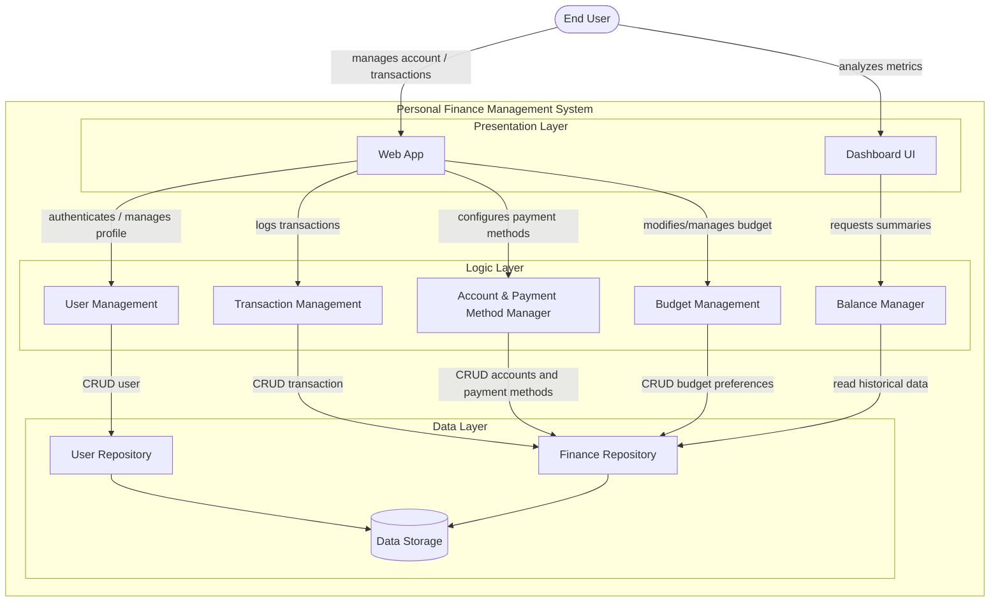
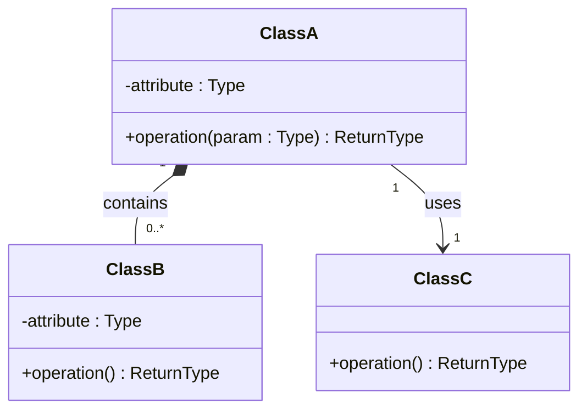

<!--
HOW TO USE THIS TEMPLATE
------------------------
1. Copy this file to docs/design/01_Architectural_and_Detailed_Design.md in your team repository.
2. This is v1.0 of work you already started: your Class 11 "Architectural Hypothesis v0.1"
   and your Class 12 "Detailed Design v0.1". Extend them to your whole system. Do not restart.
3. Use YOUR project. Generic examples (e-commerce, food delivery, banking, library) are
   only reference material and cannot be submitted as project artifacts.
4. Fill in every section. If something genuinely does not apply, write "N/A: reason".
   Never invent content to fill a blank.
5. Every diagram needs the table or argument that explains it. A diagram records design
   decisions. It does not create them.
6. Diagrams: Mermaid is preferred because it renders on GitHub. PlantUML or another tool is
   accepted if the exported image is committed and embedded in this file.
   Optionally, also add a JPG of each diagram in docs/design/diagrams/ (the Markdown prevails if they differ).
7. Read Design_Deliverable_1_Example.md for the expected level of detail. Do not copy it.
-->

# [Project Name] — Architectural & Detailed Design v1.0

| | |
|---|---|
| **Team** | |
| **Members** | |
| **Status** | Draft / Ready for review |
| **Date** | |
| **Inputs** | `docs/requirements/`, Architectural Hypothesis v0.1 (Class 11), Detailed Design v0.1 (Class 12) |

---

## 1. System Overview & Design Drivers

**System purpose** (2–3 sentences, in terms of the need it satisfies)
>

**Requirements that shape the structure** *(the ones that most influence the design, not all of them)*

| Requirement / Use Case ID | Why it shapes the structure | Quality attribute, constraint or business rule involved |
|---|---|---|
| | | |

---

## 2. Architectural Design

### 2.1 System Context & Boundary

| Outside the system | Type | How the system interacts with it |
|---|---|---|
| Usuario Final | Actor | Interactúa con la aplicación para crear su presupuesto mensual, registrar sus ingresos/gastos manuales, configurar sus medios de pago y analizar el dashboard comparativo. |

### 2.2 Components, Responsibilities & Capabilities



| Component | Main responsibility | Requirements / use cases supported | Provided capabilities | Required capabilities | Main dependencies |
|---|---|---|---|---|---|
| Web App | Provides the responsive interface for the user to input financial data from a mobile device or PC. | REQ-01, REQ-02, REQ-03, REQ-04, REQ-05, REQ-07, REQ-08 | Manages account / transactions | Authenticates / manages profile, logs transactions, configures payment methods, modifies/manages budget | User Management, Transaction Management, Account & Payment Method Manager, Budget Management |
| Dashboard UI | Presents the interactive visual panel and visually notifies about cost overruns. | REQ-06 | Analyzes metrics | Requests summaries | Balance Manager |
| User Management | Manages user identity to ensure everyone sees their own finances. | Need-01 | Authenticates / manages profile | CRUD user | User Repository |
| Transaction Management | Validates, classifies (Need/Want/Savings), and coordinates the recording of incomes and expenses. | REQ-02, REQ-03, REQ-04 | Logs transactions | CRUD transaction | Finance Repository |
| Account & Payment Method Manager | Administers the creation and modification of money sources (banks or cash). | REQ-05 | Configures payment methods | CRUD accounts and payment methods | Finance Repository |
| Budget Management | Applies the rules to create, edit categories, and set monetary limits. | REQ-01, REQ-07 | Modifies/manages budget | CRUD budget preferences | Finance Repository |
| Balance Manager | Cross-references actual data against the budget to calculate deviations and alerts. | REQ-04, REQ-06 | Requests summaries | Read historical data | Finance Repository |
| User Repository | Persists and retrieves user credentials and profiles. | Need-01 | CRUD user | Interaction with data storage | Data Storage |
| Finance Repository | Persists and retrieves budgets, transactions, and accounts, ensuring data integrity. | REQ-11 | CRUD transaction, CRUD accounts and payment methods, CRUD budget preferences, read historical data | Interaction with data storage | Data Storage |

## 3. Detailed Design

*(Inward-facing: how is each selected component designed internally?)*

### 3.1 Components selected (at least two)

| Component | Why it was selected (risk, complexity, centrality to the drivers) |
|---|---|
| | |

### 3.2 Class Diagram(s)



*(Visibility: `-` private, `+` public. Relationships: `-->` association, `*--` composition (the part cannot exist without the whole), `<|--` generalization (a specialized type of). Add multiplicity in quotes. Use composition or generalization only when their meaning is justified. Do not force them.)*

### 3.3 Class Responsibilities

| Class | Component it belongs to | Responsibility | Key collaborators |
|---|---|---|---|
| | | | |

*(Every class must belong to an identifiable component. Do not replace the component diagram with one large class diagram.)*

### 3.4 Behavior of one key operation

*(The operation you designed in Class 12, or a more important one. At most about 15 lines. Include at least one non-happy path.)*

```text

```

---

## 4. Design Quality — Cohesion, Coupling, Information Hiding

| Question | Your answer, with evidence from your design |
|---|---|
| **Cohesion:** do the responsibilities inside each class or component belong together? | |
| **Coupling:** how far does a change in one element spread? Where are the strongest dependencies? | |
| **Information hiding:** what did you keep private or internal, and why? | |

**At least one real finding** (a problem you found in your own design) **and what you changed or would change:**
>

---

## 5. Design Decisions & Decision Record

Two decisions are required: one architectural (Class 11 level) and one detailed-design (Class 12 level). Avoid "it is best practice", "it scales" or "it is cleaner" without project evidence.

### Decision A — Architectural

| | |
|---|---|
| **Context** (requirement, constraint or problem that motivated it) | |
| **Decision** | |
| **Rationale** (why it is reasonable here) | |
| **Trade-off accepted** | |

### Decision B — Detailed design

| | |
|---|---|
| **Context** | |
| **Decision** | |
| **Rationale** | |
| **Trade-off accepted** | |

### ADR

At least one of the two decisions above must also be recorded as an ADR (use `Plantilla_ADR_Nygard`) in `docs/decisions/`.

**ADR file:** `docs/decisions/ADR-XXX-title.md` — records Decision [A / B].

---

## 6. Traceability

| Requirement ID | Use Case | Component(s) | Class(es) |
|---|---|---|---|
| | | | |

*(Every requirement in Section 1 must appear. Every component and class should appear at least once. If an element traces to nothing, ask why it exists.)*

---

## 7. Optional — AI-Assisted Design Reflection

> One design recommendation generated by AI that the team accepted, modified or rejected, and why.

---

## 8. Consistency Checklist

- [ ] Every component in the diagram appears in the responsibilities table, and the other way around.
- [ ] Every class belongs to an identifiable component.
- [ ] Components are named by responsibility, not technology.
- [ ] Nothing inside the system boundary is something you do not control.
- [ ] Provided and required capabilities match across components (what one requires, another provides).
- [ ] Both decisions name a real cost or limitation, and at least one has an ADR.
- [ ] The traceability table has no empty rows and no orphan components or classes.
- [ ] Diagrams render correctly on GitHub (or the exported images are embedded).
