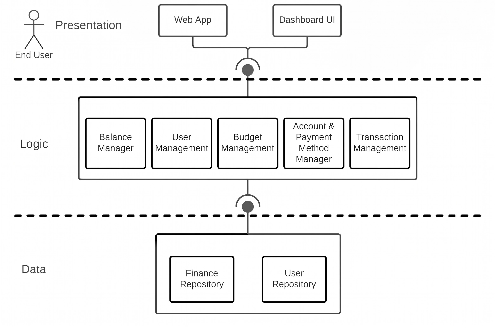
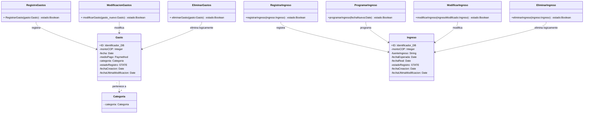

<!--
HOW TO USE THIS TEMPLATE
------------------------
1. Copy this file to docs/design/01_Architectural_and_Detailed_Design.md in your team repository.
2. This is v1.0 of work you already started: your Class 11 "Architectural Hypothesis v0.1"
   and your Class 12 "Detailed Design v0.1". Extend them to your whole system. Do not restart.
3. Use YOUR project. Generic examples (e-commerce, food delivery, banking, library) are
   only reference material and cannot be submitted as project artifacts.
4. Fill in every section. If something genuinely does not apply, write "N/A: reason".
   Never invent content to fill a blank.
5. Every diagram needs the table or argument that explains it. A diagram records design
   decisions. It does not create them.
6. Diagrams: Mermaid is preferred because it renders on GitHub. PlantUML or another tool is
   accepted if the exported image is committed and embedded in this file.
   Optionally, also add a JPG of each diagram in docs/design/diagrams/ (the Markdown prevails if they differ).
7. Read Design_Deliverable_1_Example.md for the expected level of detail. Do not copy it.
-->

# [Project Name] — Architectural & Detailed Design v1.0

| | |
|---|---|
| **Team** | |
| **Members** | |
| **Status** | Draft / Ready for review |
| **Date** | |
| **Inputs** | `docs/requirements/`, Architectural Hypothesis v0.1 (Class 11), Detailed Design v0.1 (Class 12) |

---

## 1. System Overview & Design Drivers

**System purpose** (2–3 sentences, in terms of the need it satisfies)
>

**Requirements that shape the structure** *(the ones that most influence the design, not all of them)*

| Requirement / Use Case ID | Why it shapes the structure | Quality attribute, constraint or business rule involved |
|---|---|---|
| | | |

---

## 2. Architectural Design

### 2.1 System Context & Boundary

| Outside the system | Type | How the system interacts with it |
|---|---|---|
| End User | Actor | Interacts with the application to create their monthly budget, log manual incomes and expenses, configure payment methods, and analyze the comparative dashboard. |

### 2.2 Components, Responsibilities & Capabilities



| Component | Main Responsibility | Requirements / Use Cases Supported | Provided Capabilities | Required Capabilities | Main Dependencies |
|---|---|---|---|---|---|
| Web App | Provides the responsive interface for the user to input financial data from a mobile device or PC. | REQ-01, REQ-02, REQ-03, REQ-04, REQ-05, REQ-07, REQ-08 | User management, transaction registration, and budget configuration interface | UI-to-Logic integration services | Logic Layer |
| Dashboard UI | Presents the interactive visual panel and visually notifies about cost overruns. | REQ, 04 REQ-06 | Comparative budget, balances, and trend visualization interface | Metrics & historical data analysis services | Logic Layer |
| Balance Manager | Cross-references actual data against the budget to calculate deviations and alerts. | REQ-04, REQ-06 | Budget execution calculation and alerts on overruns | Logic-to-Data integration services | Data Layer |
| User Management | Manages user identity to ensure everyone sees only their own finances. | Need-01 | User registration, authentication, and profile updates | Logic-to-Data integration services | Data Layer |
| Budget Management | Applies the rules to create, edit categories, and set monetary limits. | REQ-01, REQ-07 | Creation, categorization, and modification of monthly budgets | Logic-to-Data integration services | Data Layer |
| Account & Payment Method Manager | Administers the creation and modification of money sources (banks or cash). | REQ-05 | Configuration and validation of diverse payment methods and bank accounts | Logic-to-Data integration services | Data Layer |
| Transaction Management | Validates, classifies (Need/Want/Savings), and coordinates the recording of incomes and expenses. | REQ-02, REQ-03, REQ-04 | Logging, classification, and validation of manual and bank transactions | Logic-to-Data integration services | Data Layer |
| Finance Repository | Persists and retrieves budgets, transactions, and accounts, ensuring data integrity. | REQ-11 | Storage, querying, and updating of transactional, account, and budget data | none | none |
| User Repository | Persists and retrieves user credentials and profiles. | Need-01 | Authentication data persistence, user profiles, and session data | none | none |

## 3. Detailed Design

Cada componente se diseña con el propósito de cumplir los requerimientos establecidos, definiendo claramente la responsabilidad de cada clase, el proceso que ejecuta y el objetivo que persigue. Se busca mantener una alta cohesión dentro del módulo, de manera que sus clases trabajen de forma coordinada y estén relacionadas con una misma finalidad. Asimismo, la separación de responsabilidades permite mantener un código organizado, modular y fácil de comprender, modificar y escalar, facilitando la incorporación de nuevas funcionalidades sin afectar significativamente el funcionamiento de los componentes existentes.

### 3.1 Components selected (at least two)

| Component | Why it was selected (risk, complexity, centrality to the drivers) |
|---|---|
| **Transaction & Movement Management** | Es un componente central para la integridad financiera del sistema, ya que administra el registro, la modificación y la eliminación lógica de los gastos e ingresos. Debe garantizar la consistencia de los movimientos, conservar el historial de los cambios y evitar la pérdida de información financiera. Además, debe gestionar la clasificación de los gastos por categoría, facilitar el control del presupuesto, debe diferenciar entre la fecha esperada y la fecha real, permitiendo programar y actualizar los movimientos sin alterar la confiabilidad de la información financiera del usuario. |

### 3.2 Class Diagram(s)



### 3.3 Class Responsibilities 

| Class | Component it belongs to | Responsibility | Key collaborators |
|---|---|---|---|
| RegistroGastos | Transaction & Movement Management | Validar y coordinar el registro de un nuevo gasto. | Gasto, Categoria |
| ModificacionGastos | Transaction & Movement Management | Coordinar la modificación de los datos de un gasto existente. | Gasto, Categoria |
| EliminarGastos | Transaction & Movement Management | Realizar la eliminación lógica de un gasto y conservar su historial. | Gasto |
| Gasto | Transaction & Movement Management | Mantener la información del gasto, su estado y sus fechas de auditoría. | Categoria, clases de operaciones de gastos |
| Categoria | Transaction & Movement Management | Representar la categoría utilizada para clasificar los gastos. | Gasto |
| RegistrarIngreso | Transaction & Movement Management | Validar y coordinar el registro de un nuevo ingreso. | Ingreso |	
| ProgramarIngreso |	Transaction & Movement Management | Establecer la fecha esperada de un ingreso sin confundirla con su fecha real. | Ingreso |
| ModificarIngreso |	Transaction & Movement Management | Coordinar la modificación de la información de un ingreso existente. | Ingreso |
| EliminarIngreso	 | Transaction & Movement Management	| Realizar la eliminación lógica de un ingreso y conservar su historial. | Ingreso |
| Ingreso | Transaction & Movement Management | Mantener los datos del ingreso, su fuente, las fechas esperada y real, su estado y las fechas de auditoría. | Clases de operaciones de ingresos |

### 3.4 Behavior of one key operation


```text
Operation: RegistrarGasto(gasto:Gasto): Boolean -> Esta operación es importante porque el registro correcto de los gastos contribuye
directamente a la integridad financiera del sistema.

Flujo de comportamiento:

        // 1. Recibir la información del gasto
        Recibir gasto

        // 2. Validar los datos obligatorios y el monto
        Si los datos obligatorios están incompletos
           O el monto no es válido Entonces
            Devolver false
        FinSi

        // 3. Validar la categoría asociada
        Si la categoría no existe
           O no es válida Entonces
            Devolver false
        FinSi

        // 4. Asignar el estado inicial
        gasto.estado <- "Activo"

        // 5. Establecer las fechas de control
        gasto.fechaCreacion <- FechaActual()
        gasto.fechaUltimaModificacion <- FechaActual()

        // 6. Guardar el gasto en el sistema
        Si Guardar(gasto) = false Entonces
            Informar("No se pudo completar el registro")
            Devolver false
        FinSi

        // 7. Verificar si se supera el presupuesto
        Si gasto.monto > presupuestoDisponible(gasto.categoria) Entonces
            GenerarAlertaVisual(
                "El gasto supera el presupuesto de su categoría"
            )
        FinSi

        // 8. Confirmar el registro exitoso
        Devolver true

Happy-path: el sistema registra el gasto cuando los datos son válidos, conserva su información y permite alertar sobre un posible
exceso del presupuesto sin impedir la transacción.

Non-happy-path: si el monto es inválido, la categoría no existe o el almacenamiento falla, el gasto no debe registrarse como una
operación exitosa. El sistema debe informar el error y evitar que quede un movimiento duplicado o parcialmente registrado.
```

---

## 4. Design Quality — Cohesion, Coupling, Information Hiding

| Question | Your answer, with evidence from your design |
|---|---|
| **Cohesion:** do the responsibilities inside each class or component belong together? | |
| **Coupling:** how far does a change in one element spread? Where are the strongest dependencies? | |
| **Information hiding:** what did you keep private or internal, and why? | |

**At least one real finding** (a problem you found in your own design) **and what you changed or would change:**
>

---

## 5. Design Decisions & Decision Record

Two decisions are required: one architectural (Class 11 level) and one detailed-design (Class 12 level). Avoid "it is best practice", "it scales" or "it is cleaner" without project evidence.

### Decision A — Architectural

| **Section** | **Details** |
|:---|:---|
| **Context** | Under the requirements established in **REQ-06** (*Comparative Analysis and Visualization - Dashboard*), the system must provide processed financial summaries to generate and render the various dashboard charts. This information originates from the finance repository; however, the presentation layer (UI) must not perform these aggregation and calculation operations. In addition, **REQ-04** and business rule **RN-02** require detecting and warning about budget overruns without blocking valid transaction. Finally, **REQ-11** demands accounting data integrity. |
| **Decision** | We decided to create an isolated component **(Balance & Metrics Calculator)** responsible for retrieving raw persistent financial data from the repository, modeling it, and computing the financial metrics consumed by the dashboard. This prevents the UI from executing domain calculations and eliminates logic duplication and data inconsistencies. |
| **Rationale** | **Consistency:** Centralizing metric calculations in a dedicated component relieves the UI of responsibilities outside its scope, establishing a single, purpose-built location to enforce calculation rules.<br><br>**Integrity and Performance:** Instead of transmitting hundreds of individual transactions to the browser, the system aggregates them on the server and returns only the consolidated values and structures needed by the charts.<br><br>**Persistence Isolation:** Schema changes or structural adjustments within the persistence engine (PostgreSQL) remain isolated in the repository and do not affect the dashboard interface. |
| **Trade-off accepted** | **Transformation Overhead and Intermediate Latency:** An obligatory intermediate hop is introduced between the presentation layer and the repositories, requiring explicit Data Transfer Objects (DTOs) and mappers to translate transactional entities into chart-ready summaries.<br><br>**Rejected Alternative:** We rejected allowing `Dashboard UI` to query transactions directly and calculate balances within the client browser. Although that alternative would have reduced initial backend development effort, it exposed the system to calculation errors in the client. |

### Decision B — Detailed design

| | |
|---|---|
| **Context** |Within the `Transaction & Movement Manager` component, the system must support distinct operations for financial entries, including recording immediate expenses (**REQ-02**), logging actual incomes, and scheduling expected future incomes (**REQ-03**, **RN-03**). Each operation carries distinct validation rules, lifecycle conditions, and data integrity constraints (**REQ-11**). We needed to structure the internal classes of this component without bundling unrelated transactional behaviors into monolithic controllers|
| **Decision** |We decompose the operation logic into granular, single-purpose action classes (`RegistroGastos`, `ModificacionGastos`, `EliminarGastos` for expenses; `RegistrarIngreso`, `ProgramarIngreso`, `ModificarIngreso`, `EliminarIngreso` for incomes), each exposing a dedicated execution method over the domain entities (`Gasto` and `Ingreso`).|
| **Rationale** | **Cohesion & Single Responsibility:** Each class encapsulates the validation logic and business rules of exactly one operation. For example, `ProgramarIngreso` manages future dates and expected statuses independently from standard income logging, preventing regression bugs across unrelated flows.<br><br>**Fault & Change Isolation:** Modifying how expenses are updated or adding new pre-conditions to deletion does not touch or recompile the registration pipeline.<br><br>**Targeted Unit Testing:** Unit tests target individual operation classes in complete isolation with minimal fixture setup, directly verifying success/failure boolean results without initializing unneeded dependencies.|
| **Trade-off accepted** | **Class Proliferation (Higher Artifact Count):** Splitting lifecycle operations generates seven specialized classes instead of two unified handlers, increasing boilerplate code, file count, and dependency injection wiring overhead in the application container. <br><br>**Rejected Alternative:** We rejected consolidating all expense and income methods into centralized `GestionGastos` and `GestionIngreso` classes. While grouping them into two classes required fewer files, it produced low cohesion by accumulating multiple diverging reasons to change within a single class, violating information hiding and increasing the risk that a modification to modification or deletion logic could inadvertently break the core registration flow.|

### ADR

<!--At least one of the two decisions above must also be recorded as an ADR (use `Plantilla_ADR_Nygard`) in `docs/decisions/`. -->
The **Decision A — Architectural** has been recorded as an ADR named *(ADR-0006-dedicated-component-(Balance & Metrics Calculator))*

**ADR file:** `docs\decisions\ADR-0006-dedicated-component-(Balance & Metrics Calculator).md` — records Decision [A].

---

## 6. Traceability

| Requirement ID | Use Case | Component(s) | Class(es) |
|---|---|---|---|
| | | | |

*(Every requirement in Section 1 must appear. Every component and class should appear at least once. If an element traces to nothing, ask why it exists.)*

---

## 7. Optional — AI-Assisted Design Reflection

> One design recommendation generated by AI that the team accepted, modified or rejected, and why.

---

## 8. Consistency Checklist

- [ ] Every component in the diagram appears in the responsibilities table, and the other way around.
- [ ] Every class belongs to an identifiable component.
- [ ] Components are named by responsibility, not technology.
- [ ] Nothing inside the system boundary is something you do not control.
- [ ] Provided and required capabilities match across components (what one requires, another provides).
- [ ] Both decisions name a real cost or limitation, and at least one has an ADR.
- [ ] The traceability table has no empty rows and no orphan components or classes.
- [ ] Diagrams render correctly on GitHub (or the exported images are embedded).
