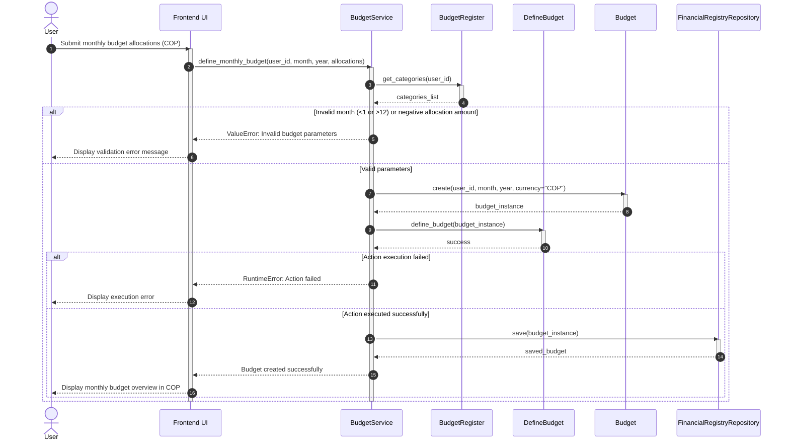
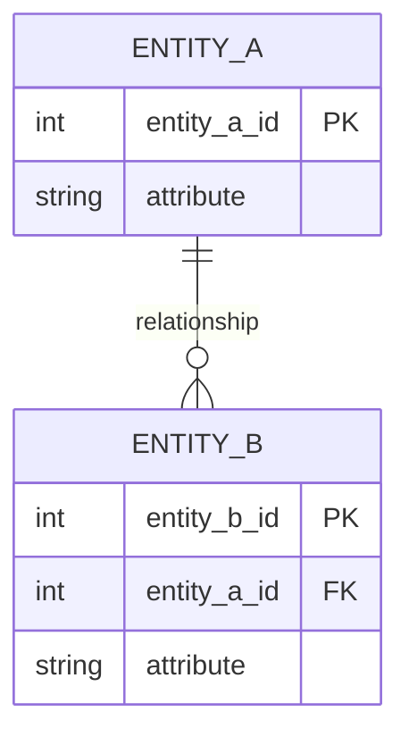

<!--
HOW TO USE THIS TEMPLATE
------------------------
1. Copy this file to docs/design/02_Interaction_and_Data_Design.md in your team repository.
2. This is v1.0 of work you started in Class 13 ("Interaction & Contracts Design v0.1").
   It builds on Deliverable 1 and must stay consistent with it. If making behavior and data
   concrete reveals a problem in Deliverable 1, update Deliverable 1 and say so in Section 4.
3. Use YOUR project. Generic examples are reference material only.
4. Sequence diagrams are derived from the Use Cases in your requirements. Do not invent
   business behavior. If something is not specified, mark it as an assumption or an Open Question.
5. If nothing in your system needs to persist, say so in Section 2.1 with your reasons. Do not
   invent a database.
6. Diagrams: Mermaid is preferred (renders on GitHub). PlantUML or another tool is accepted if
   the exported image is committed and embedded in this file.
   Optionally, also add a JPG of each diagram in docs/design/diagrams/ (the Markdown prevails if they differ).
7. Read Design_Deliverable_2_Example.md for the expected level of detail. Do not copy it.
-->

# [Project Name] — Interaction & Data Design v1.0

| | |
|---|---|
| **Team** | |
| **Members** | |
| **Status** | Draft / Ready for review |
| **Date** | |
| **Inputs** | `docs/design/01_Architectural_and_Detailed_Design.md`, Use Cases in `docs/requirements/`, Interaction & Contracts Design v0.1 (Class 13) |

---

## 1. Behavior — Selected Use Cases

Select **two** important use cases from your own project that involve meaningful interaction between components. One of them should be the use case of your capstone requirement.

### 1.1 Define Monthly Budget — from requirement [REQ-01]

**Participants:**
* **User (Actor):** user configuring monthly finance plans.
* **Frontend UI (Component):** Web/Mobile interface capturing COP budget allocations.
* **BudgetService (Backend Component):** Orchestrates monthly budget validation and workflow execution.
* **BudgetRegister (Backend Component):** Validates referenced expense categories prior to budget assignment.
* **DefineBudget (Action Class):** Executes the specific business logic for creating budget allocations.
* **Budget (Domain Entity):** Holds total COP amount, month, year, and category allocation state.
* **FinancialRegistryRepository (Persistence Component):** Persists budget data to the database.

---



---

| Use Case Step / Flow | Message(s) in the Diagram | Information Exchanged | Operation Defined in Backend |
|---|---|---|---|
| **Main Flow - Step 1** | `define_monthly_budget(user_id, month, year, allocations)` | User ID, month, year, category allocation map in COP | `BudgetService.define_monthly_budget` |
| **Main Flow - Step 2** | `get_categories(user_id)` | Category validation request | `BudgetRegister.get_categories` |
| **Main Flow - Step 3** | `Budget(user_id, month, year, currency="COP")` | Budget entity initialization parameters | `Budget.__init__` |
| **Main Flow - Step 4** | `define_budget(budget_instance)` | Configured Budget domain object | `DefineBudget.define_budget` |
| **Main Flow - Step 5** | `save(budget_instance)` | Validated Budget domain entity | `FinancialRegistryRepository.save` |
| **Alternative Flow (Input Validation Error)** | `ValueError: Invalid budget parameters` | Exception message raised when allocations are empty, month is not between 1-12, or amount < 0 | Input validation checks in `define_monthly_budget` |
| **Exception Path (Execution Error)** | `RuntimeError: Action execution failed` | Exception message raised when `DefineBudget.define_budget` returns false | Execution check block in `define_monthly_budget` |

---


### 1.2 [Second Use Case name] — from requirement [REQ-YY]

*(Same structure as 1.1.)*

---

## 2. Data Design

### 2.1 Principal information the system needs

| Information | Needed by (use cases) | Persisted? | Why (or why not) |
|---|---|---|---|
| | | Yes / No | |

*(Data owned by an external system, or recomputable on demand, is often better not persisted. If that is your decision, say so.)*

### 2.2 Data model

Choose the representation that fits your persistence approach and **justify it in one or two sentences**:
>

**Option A — Relational:** an Entity-Relationship diagram with entities, relevant attributes, primary identifiers, relationships, cardinalities and constraints.



*(Cardinality: `||` exactly one, `o|` zero or one, `}o` zero or many, `}|` one or many.)*

**Option B — Document-oriented:** collections or document types, structure, identifiers, embedded structures, references and constraints.

```json
{
  "collection_name": {
    "id": "identifier",
    "embedded_structure": [ { "field": "value" } ],
    "reference_to_other_collection": "identifier"
  }
}
```

**Other representation:** allowed if you justify why it suits your project. The goal is not to force a relational or document database. The goal is to design the information the software needs.

| Entity / document type | Meaning in the system | Identifier | Constraints (required, unique, allowed values) |
|---|---|---|---|
| | | | |

### 2.3 Data Ownership

| Information | Authoritative owner (component responsible for maintaining it) | Consumed by (uses it without owning it) | Access through |
|---|---|---|---|
| | | | |

*(Do not assume every component needs its own database. Sharing information does not mean sharing ownership. No component reads or writes another component's data directly.)*

### 2.4 Business rules and invariants enforced in data

| Business rule or invariant | Where it is enforced (component logic / data constraint / both) | How |
|---|---|---|
| | | |

---

## 3. Interface Contract

Select **one** important interaction from your sequence diagrams and specify the agreement between the two components. Technology (REST, JSON, OpenAPI) is not required.

**Interaction chosen** (from diagram 1.X, message `...`):
>

| Element | Specification |
|---|---|
| **Operation and purpose** | |
| **Input** (parameters and types) | |
| **Output** (successful result and data structure) | |
| **Preconditions** (what the caller must satisfy before invoking) | |
| **Postconditions** (what is guaranteed on successful completion) | |
| **Failure outcomes** (each failure, and what state is left after it) | |
| **Invariants and side effects** (what must stay true, what may change) | |

**Testable examples** *(optional but recommended: concrete values make guarantees checkable)*

| Case | Before | Request | Expected |
|---|---|---|---|
| | | | |

---

## 4. Cross-Consistency & Changes to Deliverable 1

| Check | Result |
|---|---|
| Every participant in a sequence diagram is an actor, a component, a class or an external system from Deliverable 1 | |
| Every message corresponds to a capability, operation or contract | |
| Every entity or document type is reflected in the class diagrams, or the reason it is not is stated | |
| Every persisted information element has exactly one authoritative owner | |
| The contract agrees with the sequence diagram and with the data model (same behavior in all three views) | |

**Changes made to Deliverable 1 because of this deliverable** *(real designs change when behavior and data become concrete. List what you updated, or write "None" and why.)*
>

---

## 5. Open Questions

> Anything unresolved about behavior or data. List it here instead of guessing.

---

## 6. Optional — AI-Assisted Design Reflection

> One design recommendation generated by AI that the team accepted, modified or rejected, and why.

---

## 7. Consistency Checklist

- [ ] Two use cases from the project, each traceable to a Use Case written in the requirements.
- [ ] Each sequence diagram shows the main flow and at least one alternative or exception flow.
- [ ] No business behavior is invented: anything unspecified is marked as an assumption or Open Question.
- [ ] Section 2.1 explains what is NOT persisted as well as what is.
- [ ] The data model has identifiers, relationships and constraints, not only boxes.
- [ ] Every piece of principal information has one authoritative owner, and consumers are listed (Section 2.3).
- [ ] The contract defines input, output, preconditions, postconditions and failure outcomes.
- [ ] Sequence, data model and contract describe the same behavior.
- [ ] Diagrams render correctly on GitHub (or the exported images are embedded).
