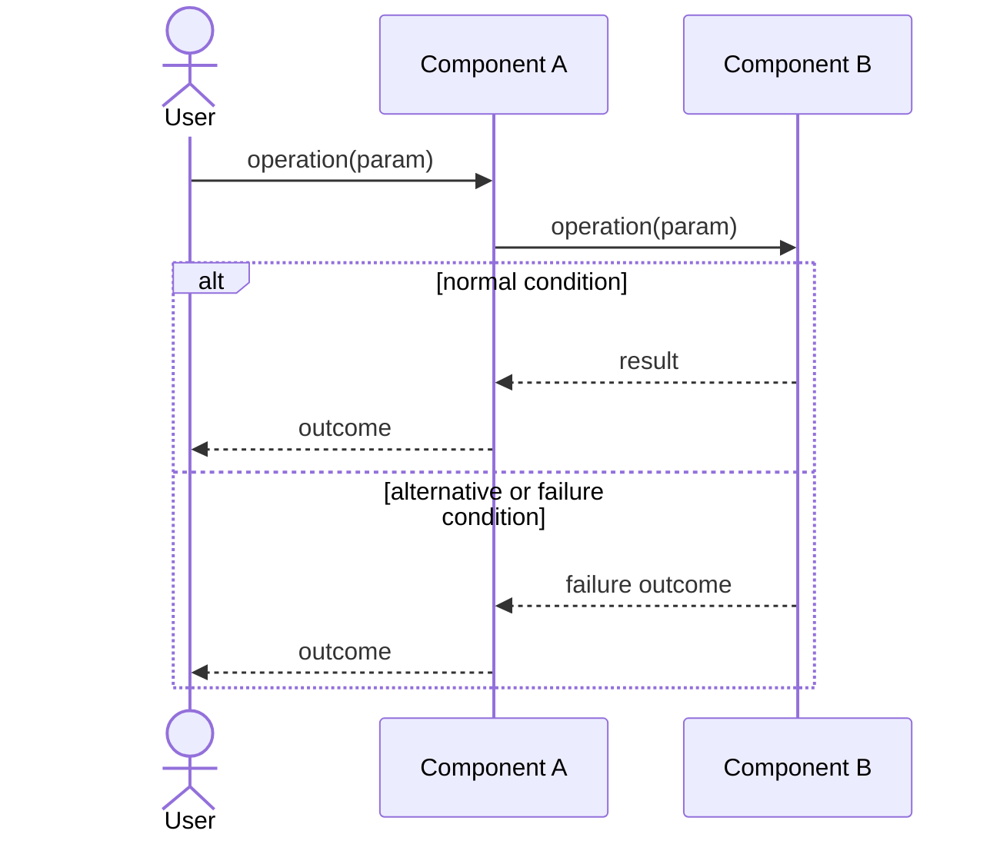
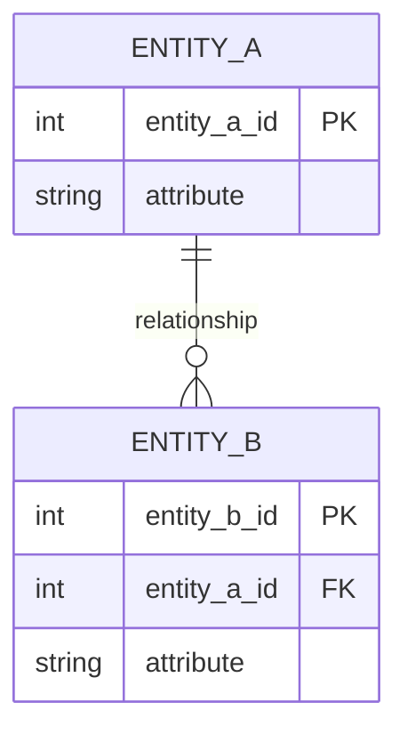

<!--
HOW TO USE THIS TEMPLATE
------------------------
1. Copy this file to docs/design/02_Interaction_and_Data_Design.md in your team repository.
2. This is v1.0 of work you started in Class 13 ("Interaction & Contracts Design v0.1").
   It builds on Deliverable 1 and must stay consistent with it. If making behavior and data
   concrete reveals a problem in Deliverable 1, update Deliverable 1 and say so in Section 4.
3. Use YOUR project. Generic examples are reference material only.
4. Sequence diagrams are derived from the Use Cases in your requirements. Do not invent
   business behavior. If something is not specified, mark it as an assumption or an Open Question.
5. If nothing in your system needs to persist, say so in Section 2.1 with your reasons. Do not
   invent a database.
6. Diagrams: Mermaid is preferred (renders on GitHub). PlantUML or another tool is accepted if
   the exported image is committed and embedded in this file.
   Optionally, also add a JPG of each diagram in docs/design/diagrams/ (the Markdown prevails if they differ).
7. Read Design_Deliverable_2_Example.md for the expected level of detail. Do not copy it.
-->

# [Project Name] — Interaction & Data Design v1.0

| | |
|---|---|
| **Team** | |
| **Members** | |
| **Status** | Draft / Ready for review |
| **Date** | |
| **Inputs** | `docs/design/01_Architectural_and_Detailed_Design.md`, Use Cases in `docs/requirements/`, Interaction & Contracts Design v0.1 (Class 13) |

---

## 1. Behavior — Selected Use Cases

Select **two** important use cases from your own project that involve meaningful interaction between components. One of them should be the use case of your capstone requirement.

### 1.1 [Use Case name] — from requirement [REQ-XX]



*(Participants are actors, components or external systems from Deliverable 1. Show the main successful flow and at least one alternative or exception flow with `alt` / `else` or `opt`. Avoid semicolons inside message text. Activation bars (`activate` / `deactivate`) are optional: use them only if you keep them balanced.)*

| Use Case step or flow | Message(s) in the diagram | Information exchanged | Operation defined in (Deliverable 1) |
|---|---|---|---|
| Main flow, step 1 | | | |
| Alternative flow | | | |
| Exception | | | |

*Check each message: does it have a purpose? Is the order correct? Is every important response shown? Are the relevant failure paths covered? Does the interaction satisfy the use case?*

### 1.2 [Second Use Case name] — from requirement [REQ-YY]

*(Same structure as 1.1.)*

---

## 2. Data Design

### 2.1 Principal information the system needs

| Information | Needed by (use cases) | Persisted? | Why (or why not) |
|---|---|---|---|
| | | Yes / No | |

*(Data owned by an external system, or recomputable on demand, is often better not persisted. If that is your decision, say so.)*

### 2.2 Data model

Choose the representation that fits your persistence approach and **justify it in one or two sentences**:
>

**Option A — Relational:** an Entity-Relationship diagram with entities, relevant attributes, primary identifiers, relationships, cardinalities and constraints.



*(Cardinality: `||` exactly one, `o|` zero or one, `}o` zero or many, `}|` one or many.)*

**Option B — Document-oriented:** collections or document types, structure, identifiers, embedded structures, references and constraints.

```json
{
  "collection_name": {
    "id": "identifier",
    "embedded_structure": [ { "field": "value" } ],
    "reference_to_other_collection": "identifier"
  }
}
```

**Other representation:** allowed if you justify why it suits your project. The goal is not to force a relational or document database. The goal is to design the information the software needs.

| Entity / document type | Meaning in the system | Identifier | Constraints (required, unique, allowed values) |
|---|---|---|---|
| | | | |

### 2.3 Data Ownership

| Information | Authoritative owner (component responsible for maintaining it) | Consumed by (uses it without owning it) | Access through |
|---|---|---|---|
| | | | |

*(Do not assume every component needs its own database. Sharing information does not mean sharing ownership. No component reads or writes another component's data directly.)*

### 2.4 Business rules and invariants enforced in data

| Business rule or invariant | Where it is enforced (component logic / data constraint / both) | How |
|---|---|---|
| | | |

---

## 3. Interface Contract

**EecordExpense** (from diagram 1.1, message `recordExpense(expense)`):
>

| Element | Specification |
|---|---|
| **Operation and purpose** | recordExpense(expense): RegistrationResult. Registers a new expense by validating its information, saving it in the financial registry, and checking whether it exceeds the budget limit assigned to its category |
| **Input** (parameters and types) | expense: Expense, containing amountCOP: Decimal, date: Date, paymentMethod: PaymentMethod, categoryId: ID, and expenseType: ExpenseType (Necessity, Desire, or Savings/Investment/Debt) |
| **Output** (successful result and data structure) | Returns a RegistrationResult containing status: Success, error: None, and alert: Overrun if the expense exceeds the budget limit, or alert: None otherwise |
| **Preconditions** (what the caller must satisfy before invoking) | The caller must provide an Expense object containing all required fields. The amount must be greater than zero, the date must be valid, and the payment method, category, and expense type must be provided. The category must exist and be valid in the system |
| **Postconditions** (what is guaranteed on successful completion) | The expense is stored in the financial registry with its information preserved. The system checks the expense against the applicable category budget and returns the appropriate alert. An expense exceeding the budget is still registered successfully; the alert informs the user without blocking the transaction |
| **Failure outcomes** (each failure, and what state is left after it) | Invalid data: Returns status: Rejected and error: InvalidData. The expense is not stored. Persistence failure: Returns status: Failed and error: StorageError. The expense must not remain partially or inconsistently stored. In both cases, the system communicates the failure to the interface and leaves the existing financial records unchanged |
| **Invariants and side effects** (what must stay true, what may change) | Existing financial records must remain consistent, and an expense must not be duplicated or partially saved. A successful registration creates a new expense record and may trigger an overspending alert. Exceeding the budget does not invalidate the expense or prevent its registration |

**Testable examples** *(optional but recommended: concrete values make guarantees checkable)*

| Case | Before | Request | Expected |
|---|---|---|---|
| Valid expense within budget | Category budget: COP 500,000. No expense with this ID exists | Record an expense of $100,000 COP | status: Success, alert: None. The expense is stored successfully |
| Valid expense exceeding budget	| Category budget: COP 500,000. Existing expenses total COP 450,000	| Record an expense of $100,000 COP 	| status: Success, alert: Overrun. The expense is stored, and the interface displays an overspending alert |
| Invalid expense amount |	No new expense has been stored	| Record an expense of $0 COP |	status: Rejected, error: InvalidData. No expense is stored |
| Missing required information | No new expense has been stored | Record an expense without specifying the payment method | status: Rejected, error: InvalidData. The interface displays a validation error |
| Persistence failure | The registry is unavailable or the save operation fails | Submit a valid expense |	status: Failed, error: StorageError. No partial expense record remains |
---

## 4. Cross-Consistency & Changes to Deliverable 1

| Check | Result |
|---|---|
| Every participant in a sequence diagram is an actor, a component, a class or an external system from Deliverable 1 | The original structure of the sequence diagram for expense registration is maintained. Its participants represent the user, the application interface, the Transaction & Movement Manager component, the Balance Manager, and the Finance Repository, whose responsibilities are defined in Deliverable 1. Adding new components was not considered necessary, since the existing structure makes it possible to represent the expense registration, storage, and budget verification flow |
| Every message corresponds to a capability, operation or contract | The messages in the sequence diagram correspond to the capabilities and operations defined in Deliverable 1. For example, submitExpense represents the submission of the form through the interface, recordExpense corresponds to the RegistroGastos.RegistrarGasto(gasto) operation, save represents the storage of the financial transaction, and verifyCategoryLimit corresponds to the Balance Manager's capability to detect budget overruns. In this way, each message has a defined purpose within the process and helps maintain traceability between the components and their responsibilities |
| Every entity or document type is reflected in the class diagrams, or the reason it is not is stated | The design retains the Gasto, Ingreso, and Categoria classes to represent financial transactions and their classification, while the Budget Manager component contains the classes related to budget and category management. The Gasto and Ingreso objects were kept separate because they have specific attributes and behaviors, such as expense classification and the distinction between the expected date and the actual date of an income. However, entities such as USER and PAYMETHOD appear in the data model without an explicit equivalent representation in the current class diagrams. Their incorporation or justification must be documented to ensure consistency between both models |
| Every persisted information element has exactly one authoritative owner | Responsibility for maintaining information is distributed according to the functions of the components. Transaction & Movement Manager manages expenses and income; Budget Manager manages budgets and categories; Account & Payment Method Manager manages accounts and payment methods; and User Management manages profiles and credentials. The repositories are responsible for persisting and retrieving information without replacing the functional responsibilities of these components. This separation helps prevent multiple components from being responsible for the same data. To fully document this decision, the Data Ownership table in Section 2.3 of Deliverable 2 must be completed |
| The contract agrees with the sequence diagram and with the data model (same behavior in all three views) | The recordExpense(expense) contract maintains the same general logic as the sequence diagram and the data model: it receives the expense information, validates the required fields, saves the transaction, and checks whether it exceeds the budget limit for its category. If an overrun occurs, the expense is successfully recorded and an alert is returned without blocking the transaction; if the data is invalid or storage fails, the corresponding result is reported. The separation between domain objects and the components responsible for executing operations is preserved. However, the explicit correspondence of the expenseType attribute with the Gasto class must be verified, and the naming conventions for components and repositories must be standardized across all three models |

---

## 5. Open Questions

> Anything unresolved about behavior or data. List it here instead of guessing.

---

## 6. Optional — AI-Assisted Design Reflection

> One design recommendation generated by AI that the team accepted, modified or rejected, and why.

---

## 7. Consistency Checklist

- [ ] Two use cases from the project, each traceable to a Use Case written in the requirements.
- [ ] Each sequence diagram shows the main flow and at least one alternative or exception flow.
- [ ] No business behavior is invented: anything unspecified is marked as an assumption or Open Question.
- [ ] Section 2.1 explains what is NOT persisted as well as what is.
- [ ] The data model has identifiers, relationships and constraints, not only boxes.
- [ ] Every piece of principal information has one authoritative owner, and consumers are listed (Section 2.3).
- [ ] The contract defines input, output, preconditions, postconditions and failure outcomes.
- [ ] Sequence, data model and contract describe the same behavior.
- [ ] Diagrams render correctly on GitHub (or the exported images are embedded).
