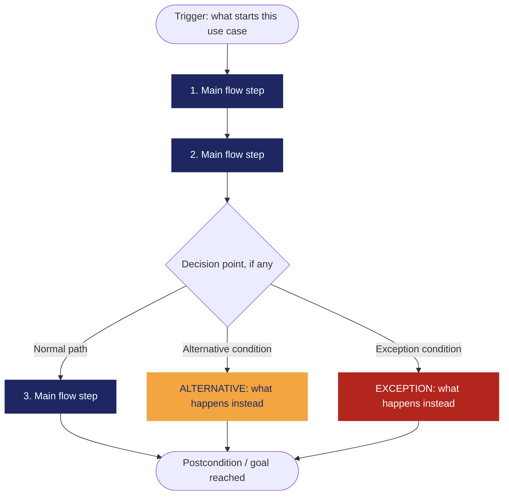

<!--
HOW TO USE THIS TEMPLATE
------------------------
1. Copy this file and rename it to the requirement's ID, e.g. REQ-01.md.
2. Fill in every section. If a section genuinely does not apply to this
   requirement (not every requirement has a Business Rule or a Constraint),
   write "N/A — none identified" and say why in one line. Never invent
   content to fill a blank cell — that breaks the rule we've followed since
   Class 8: specification is not invention.
3. If something is unknown rather than inapplicable, use the Open
   Questions section instead of guessing.
4. See REQ-07_Example.md (Food Delivery System) for a fully filled-in
   reference before you start.
-->

# [REQ-F-01] — Design of a personal monthly budget.

| | |
| --- | --- |
| **Status** | Draft / Validated / Open Question |
| **Team / Author(s)** | |
| **Date** | |
| **Linked User Story / AC** | |

---

## 1. Overview

### Requirement Statement

> The system shall [capability/behavior] [under what condition, if applicable].

**Type:** Functional / Non-functional
> *Classified using the Perfect Technology Filter from Class 8: imagine a
> perfect computer — infinite speed, unlimited memory, zero failures, zero
> cost. Would this requirement still matter? Yes → likely functional. The
> limitation disappears with perfect technology → likely non-functional.*

### Source / Evidence

> Where did this come from? (stakeholder, interview, workshop, existing system,
> regulation — reference your Class 8 Discovery Sheet entry if you have one)

### Need

> What is the underlying need, stated as a goal — not a solution? (e.g. "know
> when my order will arrive," not "build a GPS map")

### Value / Rationale

> Why does this requirement matter? What becomes better for the user/business if
> it's satisfied? *(This is usually the same as the "so that" of your User
> Story below — write it once and reuse it, don't rewrite it from scratch.)*

---

## 2. Context — A Requirement Rarely Stands Alone

> *Class 10. Fill honestly — "N/A — none identified" is a valid, expected
> answer for several of these.*

### Business Rule(s)

> BR-01 — Para que un usuario pueda gestionar sus finanzas personales en el sistema, es obligatorio contar con un presupuesto mensual de ingresos y gastos activo.

> BR-05 — Todos los gastos categorías presupuestadas deben pertenecer, obligatoriamente, a uno de los siguientes tres tipos: Necesidad; Deseo; Ahorro, Inversión y/o Deuda.

> BR-06 — Todos los montos de dinero se manejan exclusivamente en Pesos Colombianos (COP).

### Constraint(s)

> El presupuesto mensual personal sólo puede diseñarse y planearse utilizando un único tipo de cambio: el Peso Colombiano (COP).

### Assumption(s)

> Quien diseñe su presupuesto mensual *ya cuenta* con una serie de ingresos y gastos mensuales estimados que debe planear.

### Dependenc(ies)

> Es necesaria la autenticación previa de la sesión del usuario.

### Risk(s)

| Risk | Likelihood | Impact | Mitigation (optional) |
| --- | --- | --- | --- |
|El usuario final considera tediosa la planeación de cada categoría y abandona el sistema | Medio | Alto | Ofrecer categorías básicas de gasto que pueden asignarse por defecto, sin perjuicio de que el usuario final pueda modificar o añadir nuevas |

### Open Questions

> ¿Qué debe hacer el sistema en caso de que el usuario final asigne un monto a una categoría de gasto provocando que supere el total de ingresos estimados para el mes correspondiente? ¿una alerta al usuario, un límite de asignación para la categoría o un impedir que se guarde el presupuesto? Pendiente de discusión con el equipo de trabajo.

---

## 3. Priority & Estimation

**Priority model used:** MoSCoW / Kano / RICE / WSJF / Value-Effort
*(Pick the one that fits the decision you're actually making — see Class 10's
comparison if you need to decide which.)*

**Priority assigned:**
> Because [the situation/signal from your project], we assigned [priority
> value], accepting the trade-off of [what you're giving up by not prioritizing
> it higher/lower]. We considered [alternative priority] and didn't use it
> because [reason].

**Estimate (confidence):** High / Medium / Low
> How sure are we about the size and shape of this work? *(This is a
> confidence tag, not a technique-based number — named estimation techniques
> like story points are Ingeniería de Software II content, not this course.)*

---

## 4. Representations — Requirement ≠ Representation

> *Class 9. Each representation reveals different information. Fill in all
> three below — for this capstone requirement, all three are required.*

### 4.1 User Story

> As a **[role]**,
> I want **[capability]**,
> so that **[value]**.
> *Check yourself: is the "I want" describing the need, or already prescribing
> a solution?*

### 4.2 Acceptance Criteria

> *At least two scenarios: one normal path, one alternative or exception.*

#### Scenario 1 — [short name]

> **Given** [context]
> **When** [event/stimulus]
> **Then** [observable outcome]

#### Scenario 2 — [short name, alternative or exception]

> **Given** [context]
> **When** [event/stimulus]
> **Then** [observable outcome]

### 4.3 Use Case

| Field | |
| --- | --- |
| **Use Case name** | |
| **Actor** | |
| **Goal** | |
| **Trigger** | |
| **Precondition** | |

#### Main Flow

1.
2.
3.
4.

#### Alternative Flow

> [Condition] → [what happens instead]

#### Exception

> [Condition] → [what happens instead]

#### Postcondition
>

#### Flow Diagram

> *Replace the labels below with your own steps. Keep Main Flow, Alternative,
> and Exception visually distinct — delete whichever branch doesn't apply to
> your use case. This renders automatically on GitHub.*

---

## 5. Traceability & Impact

> *Class 10. Conceptual, not a formal matrix.*

**Backward — why does this requirement exist?**
> Evidence → Need → Requirement. Point to the specific evidence/need entries
> that justify this requirement (from your Discovery Sheet).

**Forward — what will this affect?**
> Requirement → future Design → Implementation → Tests. *(It's fine if Design
> hasn't happened yet — note what you expect this to touch once it does, and
> update this section once Class 11 work begins.)*

**Impact Analysis — if this requirement changes, what else might need to change?**

- [ ] Business Rules
- [ ] Constraints
- [ ] Dependencies
- [ ] Risks
- [ ] Acceptance Criteria
- [ ] Estimate
- [ ] Priority
- [ ] Future Design
- [ ] Future Tests

> Briefly note which of the above are actually likely to be affected, and why.

---

## 6. Validation — Quality Gate

> *Class 9 + Class 10. Self-audit before you commit this file. Check honestly —
> a "no" here means the requirement isn't ready yet, not that you should force
> a checkmark.*

- [ ] **Valid?** Does it reflect a real, evidenced need — not an invented one?
- [ ] **Clear / Unambiguous?** Is there only one reasonable interpretation?
- [ ] **Atomic?** Is this one independently testable expectation, not several bundled together?
- [ ] **Necessary?** Does removing it actually break something real?
- [ ] **Feasible?** Can this realistically be built with what the team has?
- [ ] **Verifiable?** Can you demonstrate, concretely, whether it's satisfied?
- [ ] **Consistent?** Does it conflict with any other requirement in your set?
- [ ] **Complete enough?** Are there important functions or constraints still missing?
- [ ] **Traceable?** Can every part of this document be traced back to real evidence — not invented to fill a section?

> If any box is unchecked, say what's missing and whether it becomes an Open
> Question or sends you back to Class 8 (re-elicit) or Class 9 (re-specify).
