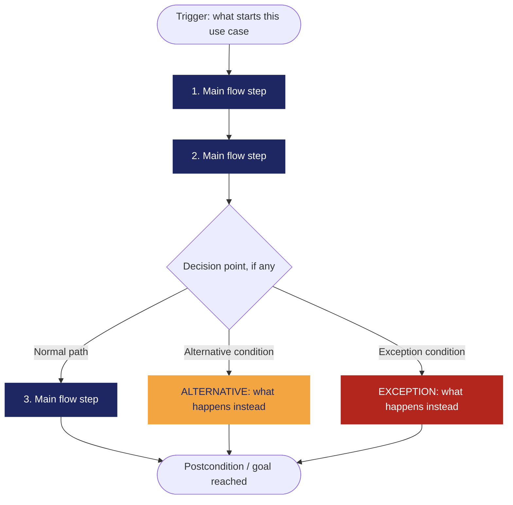

# REQ-01 — Design of a personal monthly budget.

| | |
|---|---|
| **Status** | In Review |
| **Team / Author(s)** | Kevin Daniel Flórez Hernández, Samuel Benitez Culma |
| **Date** | 2026-10-10 |
| **Linked User Story / AC** | US-01, AC-01.1, AC-01.2 | <!-- A definir con las posteriores secciones -->

---

## 1. Overview

**Requirement Statement**
> El sistema debe permitir al usuario crear, editar y consultar un único presupuesto mensual de gastos expresado exclusivamente en Pesos Colombianos (COP), indicando la cantidad de dinero destinada para cada tipo y categoría dispuesta por el usuario.

**Type:** Functional
*(Perfect Technology Filter: incluso si la tecnología funcionara a velocidad infinita, con memoria ilimitada y costo cero, el usuario aún requeriría definir y consultar sus límites presupuestarios para organizar sus finanzas. El comportamiento de negocio no desaparece, por lo tanto es Funcional.)*

**Source / Evidence**
> Discovery Sheet, Necesidad Identificada Need-01: "El usuario necesita comenzar a organizar mis finanzas personales, por ello deseo construir mi presupuesto de ingresos y gastos personal mensualmente."

**Need**
> Establecer una planificación financiera mensual estructurada por tipos y categorías de gasto que sirva como tope de referencia para el control del dinero.

**Value / Rationale**
> Proveer al usuario una base clara de planificación que le permita comparar su gasto real frente a lo planeado, facilitando la toma de decisiones informadas y promoviendo la disciplina financiera.

---

## 2. Context — A Requirement Rarely Stands Alone

> *Class 10. Fill honestly — "N/A — none identified" is a valid, expected
> answer for several of these.*

### Business Rule(s)

> BR-01 — Para que un usuario pueda gestionar sus finanzas personales en el sistema, es obligatorio contar con un presupuesto mensual de ingresos y gastos activo.

> BR-05 — Todos los gastos categorías presupuestadas deben pertenecer, obligatoriamente, a uno de los siguientes tres tipos: Necesidad; Deseo; Ahorro, Inversión y/o Deuda.

> BR-06 — Todos los montos de dinero se manejan exclusivamente en Pesos Colombianos (COP).

### Constraint(s)

> El presupuesto mensual personal sólo puede diseñarse y planearse utilizando un único tipo de cambio: el Peso Colombiano (COP).

### Assumption(s)

> Quien diseñe su presupuesto mensual *ya cuenta* con una serie de ingresos y gastos mensuales estimados que debe planear.

### Dependenc(ies)

> Es necesaria la autenticación previa de la sesión del usuario.

### Risk(s)

| Risk | Likelihood | Impact | Mitigation (optional) |
| --- | --- | --- | --- |
|El usuario final considera tediosa la planeación de cada categoría y abandona el sistema | Medio | Alto | Ofrecer categorías básicas de gasto que pueden asignarse por defecto, sin perjuicio de que el usuario final pueda modificar o añadir nuevas |

### Open Questions

> ¿Qué debe hacer el sistema en caso de que el usuario final asigne un monto a una categoría de gasto provocando que supere el total de ingresos estimados para el mes correspondiente? ¿una alerta al usuario, un límite de asignación para la categoría o un impedir que se guarde el presupuesto? Pendiente de discusión con el equipo de trabajo.

---

## 3. Priority & Estimation

**Priority model used:** MoSCoW / Kano / RICE / WSJF / Value-Effort
*(Pick the one that fits the decision you're actually making — see Class 10's
comparison if you need to decide which.)*

**Priority assigned:**

> **Priority model use:** RICE and MoSCoW
> **Priority assigned:** 4.8 (RICE) / Must-have (MoSCoW)

> Because the main objective of this firts phase was to establish the core logic required for our application to function, we assigned the ***Gestion de Presupuesto Mensual*** requirement a **RICE** score of **4.8** and classified it as a **Must-have** using **MoSCoW**. We accepted the trade-off of postponing more advanced features to focus on implementing the application's essential functionality first, as these core funtions provide the foundation for future enhancements.
>  We considered ***Personalización de Categorías de Gasto*** and ***Registro de Ingresos*** while we were comparing them. Even so, we decided to implement  ***Gestion de Presupuesto Mensual*** first as the others were less relevant for our objective, for these reason them are the next requirements in the priority order.

**Estimate (confidence):** High / Medium / Low
> We assigned an 80% confidence level because the requirement covers a core system function. However, since the estimate is not yet supported by sufficient evidence or validation, it should be treated as a provisional estimate rather than a confirmed result.

>| Name | Reach | Impact | Confidence (%) | Effort | MoSCoW | RICE Score |
>|---|---:|---:|---:|---:|---|---:|
>| Registro de gastos | 10 | 2 | 80 | 3 | Must | 5.33 |
>| Registro de Ingresos | 10 | 2 | 80 | 3 | Must | 5.33 |
>| Gestión de Presupuesto Mensual | 10 | 3 | 80 | 5 | Must | 4.80 |
>| Personalización de Categorías de Gasto | 7 | 2 | 80 | 3 | Should | 3.73 |
>| Análisis Comparativo y Visualización (Dashboard) | 10 | 2 | 80 | 6 | Should | 2.67 |
>| Gestión de Cuentas y Medios de Pago | 8 | 2 | 80 | 5 | Should | 2.56 |
>| Notificación / Alerta Visual de Sobrecosto | 7 | 1 | 70 | 3 | Should | 1.63 |

>*notes:*
> *1. The time frame allocated for each feature is one moth after the application is launched*
> *2. The selected requirementes were chosen as the foundations for the application's operation*
> *3. The estimated effort was measured in person-days, based on the munber of working days in a month*
> *4. The overall goal of this set of requirements is to ensure that the application's core funtionalities work correctly*
---

## 4. Representations — Requirement ≠ Representation

> *Class 9. Each representation reveals different information. Fill in all
> three below — for this capstone requirement, all three are required.*

### 4.1 User Story

> As a **[role]**,
> I want **[capability]**,
> so that **[value]**.
> *Check yourself: is the "I want" describing the need, or already prescribing
> a solution?*

### 4.2 Acceptance Criteria

> *At least two scenarios: one normal path, one alternative or exception.*

#### Scenario 1 — [short name]

> **Given** [context]
> **When** [event/stimulus]
> **Then** [observable outcome]

#### Scenario 2 — [short name, alternative or exception]

> **Given** [context]
> **When** [event/stimulus]
> **Then** [observable outcome]

### 4.3 Use Case

| Field | |
| --- | --- |
| **Use Case name** | |
| **Actor** | |
| **Goal** | |
| **Trigger** | |
| **Precondition** | |

#### Main Flow

1.
2.
3.
4.

#### Alternative Flow

> [Condition] → [what happens instead]

#### Exception

> [Condition] → [what happens instead]

#### Postcondition
>

#### Flow Diagram

> *Replace the labels below with your own steps. Keep Main Flow, Alternative,
> and Exception visually distinct — delete whichever branch doesn't apply to
> your use case. This renders automatically on GitHub.*

---

# 5. Traceability & Impact

## Backward Traceability — ¿Por qué existe este requisito?

**Evidencia:** [E-XX] — Evidencia del *Discovery Sheet* que demuestra la necesidad del usuario de planificar y controlar sus gastos mensuales.

**Necesidad:** [N-01] — El usuario necesita comenzar a organizar mis finanzas personales, por ello deseo construir mi presupuesto de ingresos y gastos personal mensualmente.

**Requisito:** El sistema debe permitir a cada usuario crear, editar y consultar un único presupuesto mensual de gastos, expresado exclusivamente en pesos colombianos (COP), asignando montos de dinero a las categorías de gastos disponibles para dicho usuario.

Este requisito existe porque los usuarios necesitan organizar sus gastos mensuales, establecer límites de gasto para diferentes categorías y contar con una referencia para administrar su dinero.

## Forward Traceability — ¿Qué elementos se verán afectados?

**Diseño futuro:**
- Una interfaz para crear y editar el presupuesto mensual.
- Un formulario para asignar montos de dinero a las categorías de gastos.
- Una vista que muestre el presupuesto y los montos asignados a cada categoría.
- Una opción de navegación para acceder al presupuesto mensual del usuario.

**Implementación:**
- Componentes y formularios del frontend para crear, editar y consultar presupuestos.
- Operaciones del backend para guardar, actualizar y consultar la información de los presupuestos.
- Estructuras en la base de datos para relacionar cada presupuesto con su usuario, mes y distribución por categorías.
- Validaciones para garantizar que los montos se manejen exclusivamente en COP y que cada usuario tenga un solo presupuesto por mes.

**Pruebas futuras:**
- Verificar que un usuario pueda crear, editar y consultar un presupuesto mensual.
- Verificar que el sistema no permita crear más de un presupuesto para el mismo mes por usuario.
- Verificar que los montos se manejen exclusivamente en COP.
- Verificar que se puedan asignar montos a las categorías de gastos disponibles.

Estos elementos son previsiones iniciales y deberán actualizarse cuando comience el diseño detallado y la implementación.

## Impact Analysis — ¿Qué más podría cambiar si este requisito se modifica?

- **Reglas de negocio:** Si cambia la restricción de un presupuesto por mes, el periodo del presupuesto o las categorías disponibles para cada usuario, podrían modificarse las reglas para crear y editar presupuestos.

- **Restricciones:** Si se cambia el requisito para permitir monedas distintas al COP o cambiar el periodo mensual se debe modificar el diseño e implementación del sistema para permitir más tipos de monedas o periodicidades.

- **Dependencias:** El presupuesto depende de las categorías de gastos disponibles por lo que el requisito puede abarcar más o menos categorías a futuro.

- **Riesgos:** Modificar la distribución de ingresos por categorías podría generar presupuestos duplicados, asignaciones inconsistentes o dificultades para comparar los gastos planeados con los gastos reales.

- **Criterios de aceptación:** Los cambios en el periodo del presupuesto, la moneda o la asignación por categorías requerirían revisar las condiciones que determinan si el requisito se ha cumplido.

- **Estimación:** Si cambia el requisito, en términos de trabajo adicional se puede requerir más tiempo de desarrollo si se amplía el requisito para permitir varios presupuestos por mes, múltiples monedas o reglas de distribución más complejas.

- **Prioridad:** Si cambia el requisito, la prioridad del mismo no cambiaría radicalmente respecto a otros requisitos, puesto que el requisito sigue siendo esencial para el proyecto, sin embargo, La prioridad de las funcionalidades del sistema que se deben desarrollar a partir de este requisito podrían cambiar.

- **Diseño futuro:** Los cambios podrían afectar los formularios del presupuesto, la interfaz de distribución por categorías, el resumen del presupuesto y la navegación, es decir, podría tener que modificarse el diseño de front y backend principalmente.

- **Pruebas futuras:** Los casos de prueba tendrían que actualizarse para cubrir las nuevas reglas, validaciones o comportamientos introducidos por los cambios.

Se considerará que lo que más probabilidades tiene de cambiar son las restricciones y las dependencias del requisito, y si eso cambia, se debería modificar los criterios de aceptación, la estimación del trabajo requerido, el diseño y las pruebas futuras.

---

## 6. Validation — Quality Gate

> *Class 9 + Class 10. Self-audit before you commit this file. Check honestly —
> a "no" here means the requirement isn't ready yet, not that you should force
> a checkmark.*

- [ ] **Valid?** Does it reflect a real, evidenced need — not an invented one?
- [ ] **Clear / Unambiguous?** Is there only one reasonable interpretation?
- [ ] **Atomic?** Is this one independently testable expectation, not several bundled together?
- [ ] **Necessary?** Does removing it actually break something real?
- [ ] **Feasible?** Can this realistically be built with what the team has?
- [ ] **Verifiable?** Can you demonstrate, concretely, whether it's satisfied?
- [ ] **Consistent?** Does it conflict with any other requirement in your set?
- [ ] **Complete enough?** Are there important functions or constraints still missing?
- [ ] **Traceable?** Can every part of this document be traced back to real evidence — not invented to fill a section?

> If any box is unchecked, say what's missing and whether it becomes an Open
> Question or sends you back to Class 8 (re-elicit) or Class 9 (re-specify).
