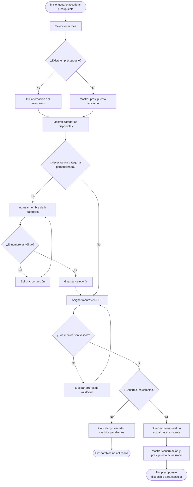

# REQ-01 — Design of a personal monthly budget.

| | |
|---|---|
| **Status** | In Review |
| **Team / Author(s)** | Kevin Daniel Flórez Hernández, David Esteban Sainea Rubio, Joger Ivan Muñoz Dueñas, Samuel Benítez Culma, Miguel Ángel Guativa Archila |
| **Date** | 2026-10-10 |
| **Linked User Story / AC** | US-01, AC-01.1, AC-01.2 | <!-- A definir con las posteriores secciones -->

---

## 1. Overview

**Requirement Statement**
> El sistema debe permitir al usuario crear, editar y consultar un único presupuesto mensual de gastos expresado exclusivamente en Pesos Colombianos (COP), indicando la cantidad de dinero destinada para cada tipo y categoría dispuesta por el usuario.

**Type:** Functional
*(Perfect Technology Filter: incluso si la tecnología funcionara a velocidad infinita, con memoria ilimitada y costo cero, el usuario aún requeriría definir y consultar sus límites presupuestarios para organizar sus finanzas. El comportamiento de negocio no desaparece, por lo tanto es Funcional.)*

**Source / Evidence**
> Discovery Sheet, Necesidad Identificada Need-01: "El usuario necesita comenzar a organizar mis finanzas personales, por ello deseo construir mi presupuesto de ingresos y gastos personal mensualmente."

**Need**
> Establecer una planificación financiera mensual estructurada por tipos y categorías de gasto que sirva como tope de referencia para el control del dinero.

**Value / Rationale**
> Proveer al usuario una base clara de planificación que le permita comparar su gasto real frente a lo planeado, facilitando la toma de decisiones informadas y promoviendo la disciplina financiera.

---

## 2. Context — A Requirement Rarely Stands Alone

> *Class 10. Fill honestly — "N/A — none identified" is a valid, expected
> answer for several of these.*

### Business Rule(s)

> BR-01 — Para que una persona pueda gestionar sus finanzas personales y tener seguimiento de sus gastos, es necesario idear y construir un presupuesto mensual de ingresos y gastos.

> BR-05 — Todos los gastos categorías presupuestadas deben pertenecer, obligatoriamente, a uno de los siguientes tres tipos: Necesidad; Deseo; Ahorro, Inversión y/o Deuda.

> BR-06 — Todos los montos de dinero se manejan exclusivamente en Pesos Colombianos (COP).

### Constraint(s)

> El presupuesto mensual personal sólo puede diseñarse y planearse utilizando un único tipo de cambio: el Peso Colombiano (COP).

### Assumption(s)

> Quien diseñe su presupuesto mensual *ya cuenta* con una serie de ingresos y gastos mensuales estimados que debe planear.

### Dependenc(ies)

> Es necesaria la autenticación previa de la sesión del usuario.

### Risk(s)

| Risk | Likelihood | Impact | Mitigation (optional) |
| --- | --- | --- | --- |
|El usuario final considera tediosa la planeación de cada categoría y abandona el sistema | Medio | Alto | Ofrecer categorías básicas de gasto que pueden asignarse por defecto, sin perjuicio de que el usuario final pueda modificar o añadir nuevas |

### Open Questions

> ¿Qué debe hacer el sistema en caso de que el usuario final asigne un monto a una categoría de gasto provocando que supere el total de ingresos estimados para el mes correspondiente? ¿una alerta al usuario, un límite de asignación para la categoría o un impedir que se guarde el presupuesto? Pendiente de discusión con el equipo de trabajo.

---

## 3. Priority & Estimation

**Priority model used:** MoSCoW / Kano / RICE / WSJF / Value-Effort
*(Pick the one that fits the decision you're actually making — see Class 10's
comparison if you need to decide which.)*

**Priority assigned:**

> **Priority model use:** RICE and MoSCoW
> **Priority assigned:** 4.8 (RICE) / Must-have (MoSCoW)

> Dado que el objetivo principal de esta primera fase era establecer la lógica central necesaria para que nuestra aplicación funcionara, asignamos al requisito ***Gestión de Presupuesto Mensual*** una puntuación **RICE de 4.8** y lo clasificamos como **Imprescindible (*Must-have*)** según el modelo **MoSCoW**. Aceptamos la contrapartida de posponer las funcionalidades más avanzadas para centrarnos primero en implementar las funcionalidades esenciales de la aplicación, ya que estas funciones centrales constituyen la base para futuras mejoras.

> Consideramos los requisitos ***Personalización de Categorías de Gasto*** y ***Registro de Ingresos*** durante el proceso de comparación. Aun así, decidimos implementar primero ***Gestión de Presupuesto Mensual***, ya que los otros requisitos eran menos relevantes para nuestro objetivo. Por esta razón, ambos se ubican a continuación en el orden de prioridad.

**Estimate (confidence):** High / Medium / Low
> Asignamos un nivel de confianza del 80 % porque el requisito abarca una función central del sistema. Sin embargo, dado que la estimación aún no está respaldada por evidencia suficiente ni ha sido validada, debe considerarse una estimación provisional y no un resultado confirmado.

>| Name | Reach | Impact | Confidence (%) | Effort | MoSCoW | RICE Score |
>|---|---:|---:|---:|---:|---|---:|
>| Registro de gastos | 10 | 2 | 80 | 3 | Must | 5.33 |
>| Registro de Ingresos | 10 | 2 | 80 | 3 | Must | 5.33 |
>| Gestión de Presupuesto Mensual | 10 | 3 | 80 | 5 | Must | 4.80 |
>| Personalización de Categorías de Gasto | 7 | 2 | 80 | 3 | Should | 3.73 |
>| Análisis Comparativo y Visualización (Dashboard) | 10 | 2 | 80 | 6 | Should | 2.67 |
>| Gestión de Cuentas y Medios de Pago | 8 | 2 | 80 | 5 | Should | 2.56 |
>| Notificación / Alerta Visual de Sobrecosto | 7 | 1 | 70 | 3 | Should | 1.63 |

> *Notas:*
>
> *1. El plazo asignado para cada funcionalidad es de un mes después del lanzamiento de la aplicación.*
> *2. Los requisitos seleccionados se eligieron como base para el funcionamiento de la aplicación.*
> *3. El esfuerzo estimado se midió en días-persona, teniendo en cuenta el número de días laborables de un mes.*
> *4. El objetivo general de este conjunto de requisitos es garantizar que las funcionalidades principales de la aplicación funcionen correctamente.*
---

## 4. Representations — Requirement ≠ Representation

### 4.1 User Story

> Como **usuario de la aplicación**,
>
> quiero **crear, organizar, consultar y modificar mi presupuesto mensual mediante la asignación de montos a las categorías de gastos disponibles y a las categorías personalizadas que necesite**,
>
> para **organizar mis gastos de acuerdo con mis necesidades y prioridades, y mantener actualizada la distribución de mi presupuesto mensual**.

### 4.2 Acceptance Criteria

#### Escenario 1 — Configuración exitosa del presupuesto

> **Dado** que el usuario ha ingresado a la aplicación y está creando o editando el presupuesto de un mes seleccionado,
>
> **Cuando** asigna montos válidos en pesos colombianos (COP) a las categorías de gastos que desea utilizar, incluidas las categorías personalizadas que necesite, y confirma los cambios,
>
> **Entonces** el sistema valida y guarda la configuración del presupuesto, confirma que los cambios se guardaron correctamente y permite consultar la configuración actualizada.

#### Escenario 2 — Datos inválidos o presupuesto existente

> **Dado** que el usuario está creando o editando un presupuesto mensual,
>
> **Cuando** intenta guardar valores que no cumplen las reglas de validación del sistema o intenta crear otro presupuesto para un mes que ya tiene uno registrado,
>
> **Entonces** el sistema identifica los valores que deben corregirse y no guarda los cambios afectados hasta que cumplan las reglas de validación. Si ya existe un presupuesto para el mes seleccionado, el sistema permite consultar o editar el presupuesto existente en lugar de crear uno duplicado.

### 4.3 Use Case

| Field |  |
|---|---|
| **Nombre del caso de uso** | Gestión del presupuesto mensual |
| **Actor** | Usuario de la aplicación |
| **Objetivo** | Organizar y distribuir los gastos mensuales de acuerdo con las necesidades y prioridades del usuario. |
| **Disparador** | El usuario accede a la sección de presupuesto mensual para crear, consultar o modificar un presupuesto. |
| **Precondición** | El usuario debe haber ingresado a la aplicación. El sistema debe poder determinar si ya existe un presupuesto para el mes seleccionado. |

#### Main Flow

1. El usuario accede a la sección de presupuesto mensual y selecciona el mes que desea gestionar.
2. El sistema verifica si existe un presupuesto para el mes seleccionado. Si existe, muestra su configuración actual; de lo contrario, permite iniciar su creación.
3. El sistema presenta las categorías de gastos disponibles y los montos asignados, cuando corresponda. El usuario selecciona las categorías, crea categorías personalizadas si las necesita y asigna los montos deseados en COP.
4. El usuario confirma los cambios. El sistema valida la información, guarda el nuevo presupuesto o actualiza el existente y muestra la configuración actualizada junto con un mensaje de confirmación.

#### Alternative Flow

> **Las categorías disponibles no cubren las necesidades del usuario:** el usuario selecciona la opción para crear una categoría personalizada, introduce su nombre y confirma la operación. El sistema valida la información, guarda la categoría y permite utilizarla en la configuración del presupuesto.

#### Exception

> **Datos inválidos:** el sistema identifica los valores que deben corregirse y no guarda los cambios afectados hasta que cumplan las reglas de validación.

> **Cancelación de cambios:** si el usuario cancela la operación antes de guardar, el sistema descarta las modificaciones pendientes.

> **Presupuesto existente:** si ya existe un presupuesto para el mes seleccionado, el sistema permite consultar o editar el presupuesto existente en lugar de crear otro para el mismo mes.

#### Postcondition

El presupuesto del mes seleccionado queda guardado o actualizado con las categorías y los montos validados en pesos colombianos (COP), y puede ser consultado posteriormente por el usuario. Si la operación se cancela antes de guardar, las modificaciones pendientes no se aplican.

#### Flow Diagram

# 5. Traceability & Impact

## Backward Traceability — ¿Por qué existe este requisito?

**Evidencia:** [E-01] — Durante la exploración inicial de las prácticas de manejo de las finanzas personales entre familiares y miembros del equipo, se identificaron distintas formas de controlar el dinero: algunas personas no llevan un registro organizado, otras calculan mentalmente cuánto pueden gastar y otras utilizan hojas de cálculo. Estas alternativas pueden dificultar el seguimiento organizado de los gastos y la planificación del dinero disponible durante el mes.

Además, la investigación documental sobre finanzas personales destaca el uso de presupuestos mensuales que distribuyen el dinero entre diferentes tipos y categorías de gastos, con el propósito de organizar los recursos disponibles y establecer límites de gasto.

**Necesidad:** [N-01] — El usuario necesita comenzar a organizar sus finanzas personales, por ello desea construir su presupuesto de ingresos y gastos personales mensualmente.

**Requisito:** El sistema debe permitir a cada usuario crear, editar y consultar un único presupuesto mensual de gastos, expresado exclusivamente en pesos colombianos (COP), asignando montos de dinero a las categorías de gastos disponibles para dicho usuario.

Este requisito existe porque los usuarios necesitan organizar sus gastos mensuales, establecer límites de gasto para diferentes categorías y contar con una referencia para administrar su dinero.

## Forward Traceability — ¿Qué elementos se verán afectados?

**Diseño futuro:**
- Una interfaz para crear y editar el presupuesto mensual.
- Un formulario para asignar montos de dinero a las categorías de gastos.
- Una vista que muestre el presupuesto y los montos asignados a cada categoría.
- Una opción de navegación para acceder al presupuesto mensual del usuario.

**Implementación:**
- Componentes y formularios del frontend para crear, editar y consultar presupuestos.
- Operaciones del backend para guardar, actualizar y consultar la información de los presupuestos.
- Estructuras en la base de datos para relacionar cada presupuesto con su usuario, mes y distribución por categorías.
- Validaciones para garantizar que los montos se manejen exclusivamente en COP y que cada usuario tenga un solo presupuesto por mes.

**Pruebas futuras:**
- Verificar que un usuario pueda crear, editar y consultar un presupuesto mensual.
- Verificar que el sistema no permita crear más de un presupuesto para el mismo mes por usuario.
- Verificar que los montos se manejen exclusivamente en COP.
- Verificar que se puedan asignar montos a las categorías de gastos disponibles.

Estos elementos son previsiones iniciales y deberán actualizarse cuando comience el diseño detallado y la implementación.

## Impact Analysis — ¿Qué más podría cambiar si este requisito se modifica?

- **Reglas de negocio:** Si cambia la restricción de un presupuesto por mes, el periodo del presupuesto o las categorías disponibles para cada usuario, podrían modificarse las reglas para crear y editar presupuestos.

- **Restricciones:** Si se cambia el requisito para permitir monedas distintas al COP o cambiar el periodo mensual se debe modificar el diseño e implementación del sistema para permitir más tipos de monedas o periodicidades.

- **Dependencias:** El presupuesto depende de las categorías de gastos disponibles por lo que el requisito puede abarcar más o menos categorías a futuro.

- **Riesgos:** Modificar la distribución de ingresos por categorías podría generar presupuestos duplicados, asignaciones inconsistentes o dificultades para comparar los gastos planeados con los gastos reales.

- **Criterios de aceptación:** Los cambios en el periodo del presupuesto, la moneda o la asignación por categorías requerirían revisar las condiciones que determinan si el requisito se ha cumplido.

- **Estimación:** Si cambia el requisito, en términos de trabajo adicional se puede requerir más tiempo de desarrollo si se amplía el requisito para permitir varios presupuestos por mes, múltiples monedas o reglas de distribución más complejas.

- **Prioridad:** Si cambia el requisito, la prioridad del mismo no cambiaría radicalmente respecto a otros requisitos, puesto que el requisito sigue siendo esencial para el proyecto, sin embargo, La prioridad de las funcionalidades del sistema que se deben desarrollar a partir de este requisito podrían cambiar.

- **Diseño futuro:** Los cambios podrían afectar los formularios del presupuesto, la interfaz de distribución por categorías, el resumen del presupuesto y la navegación, es decir, podría tener que modificarse el diseño de front y backend principalmente.

- **Pruebas futuras:** Los casos de prueba tendrían que actualizarse para cubrir las nuevas reglas, validaciones o comportamientos introducidos por los cambios.

Se considerará que lo que más probabilidades tiene de cambiar son las restricciones y las dependencias del requisito, y si eso cambia, se debería modificar los criterios de aceptación, la estimación del trabajo requerido, el diseño y las pruebas futuras.

---

## 6. Validation — Quality Gate

> *Class 9 + Class 10. Self-audit before you commit this file. Check honestly —
> a "no" here means the requirement isn't ready yet, not that you should force
> a checkmark.*

## 6. Validation — Quality Gate

- [x] **Valid?** Sí — se relaciona directamente con la necesidad N-01, que identifica la necesidad del usuario de organizar sus finanzas personales mediante un presupuesto mensual de ingresos y gastos. La evidencia E-01 también describe las prácticas actuales de administración del dinero y las dificultades que pueden generar para una planificación financiera organizada.
- [ ] **Clear / Unambiguous?** No completamente — la expectativa principal es comprensible, pero algunos detalles siguen abiertos a interpretación. Por ejemplo, no se definen por completo las reglas de validación de los montos.
- [x] **Atomic?** Sí — el requerimiento se centra en una capacidad principal: gestionar un único presupuesto mensual de gastos en COP, incluyendo su creación, edición y consulta. Aunque comprende varias operaciones, todas pertenecen a la misma funcionalidad y pueden probarse como parte de ella; no se están agrupando requisitos ajenos entre sí.
- [x] **Necessary?** Sí — eliminar este requerimiento suprimiría la funcionalidad principal que permite a los usuarios planificar sus gastos mensuales y establecer límites por categoría. Esto afectaría directamente la necesidad N-01 y el propósito central de la aplicación.
- [x] **Feasible?** Sí — el requerimiento puede implementarse mediante formularios y vistas en el frontend, operaciones en el backend y estructuras en la base de datos para crear, actualizar y consultar presupuestos mensuales. Estos elementos ya están identificados en la sección de trazabilidad futura. Sin embargo, la factibilidad técnica detallada deberá confirmarse durante el diseño y la implementación.
- [x] **Verifiable?** Sí — los criterios de aceptación AC-01.1 y AC-01.2 describen condiciones observables para guardar un presupuesto válido, gestionar datos inválidos y evitar presupuestos duplicados para un mismo mes. Las pruebas futuras de la sección 5 también indican cómo verificar la creación, edición y consulta del presupuesto, así como el uso de COP. Una vez definidas las reglas pendientes, podrían necesitarse pruebas adicionales.
- [x] **Consistent?** Sí, - Es consistente con la regla de negocio BR-01, que indica que una persona debe contar obligatoriamente con un presupuesto para poder tener finanzas personales. Este requisito sigue esa premisa. 
- [ ] **Complete enough?** No completamente — el requerimiento cubre las principales operaciones de gestión del presupuesto, pero la pregunta abierta de la sección 2 sigue sin resolverse: ¿qué debe ocurrir cuando los montos asignados a las categorías de gasto superan los ingresos mensuales estimados del usuario? 
- [x] **Traceable?** Si — la funcionalidad principal está vinculada con la necesidad N-01 y la evidencia E-01, y se identifican sus impactos futuros en el diseño, la implementación y las pruebas. 

> If any box is unchecked, say what's missing and whether it becomes an Open
> Question or sends you back to Class 8 (re-elicit) or Class 9 (re-specify).
