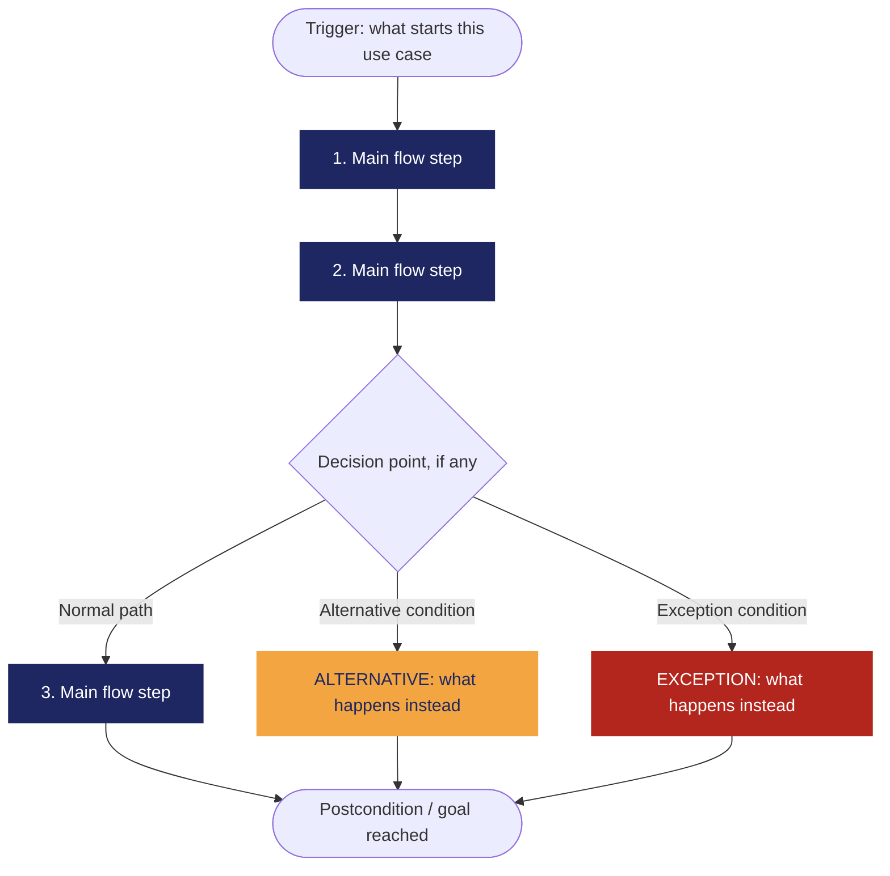

<!--
HOW TO USE THIS TEMPLATE
------------------------
1. Copy this file and rename it to the requirement's ID, e.g. REQ-01.md.
2. Fill in every section. If a section genuinely does not apply to this
   requirement (not every requirement has a Business Rule or a Constraint),
   write "N/A — none identified" and say why in one line. Never invent
   content to fill a blank cell — that breaks the rule we've followed since
   Class 8: specification is not invention.
3. If something is unknown rather than inapplicable, use the Open
   Questions section instead of guessing.
4. See REQ-07_Example.md (Food Delivery System) for a fully filled-in
   reference before you start.
-->

# REQ-02 — Registro de Gastos

| | |
|---|---|
| **Status** | In Review |
| **Team / Author(s)** | Kevin Daniel Flórez Hernández, David Esteban Sainea Rubio, Joger Iván Muñoz Dueñas, Samuel Benítez Culma, Miguel Ángel Guativa Archila |
| **Date** | 2026-10-10 |
| **Linked User Story / AC** | US-02, AC-02.1, AC-02.2 |

---

## 1. Overview

**Requirement Statement**
> El sistema debe permitir registrar un gasto capturando obligatoriamente: Monto (en COP), Fecha, Medio de Pago/Cuenta, Categoría y Tipo de Gasto (Necesidad, Deseo o Ahorro/Inversión/Deuda).

**Type:** Functional
*(Perfect Technology Filter: incluso si la tecnología funcionara a velocidad infinita, con memoria ilimitada y costo cero, el usuario aún necesitaría ingresar la información de las transacciones que realiza en su vida cotidiana para llevar el control de su dinero. El comportamiento de negocio no desaparece, por lo tanto es Funcional.)*

**Source / Evidence**
> Discovery Sheet, Necesidad Identificada Need-02: "El usuario necesita registrar un gasto hecho durante el día, siguiendo las recomendaciones de los expertos: que tenga tipo, categoría, monto, fecha y medio de pago."

**Need**
> Asociar cada salida diaria de dinero con sus atributos descriptivos clave (monto, fecha, fuente de pago, categoría y clasificación) para mantener la trazabilidad de los egresos.

**Value / Rationale**
> Permitir al usuario mantener un historial detallado y organizado de sus hábitos de consumo diarios, habilitando el control en tiempo real frente al presupuesto definido y la identificación de sobrecostos.
---

## 2. Context — A Requirement Rarely Stands Alone

*(Class 10. Fill honestly — "N/A — none identified" is a valid, expected answer for several of these.)*

**Business Rule(s)**
> What rule(s) exist in the business/domain, independent of software, that this requirement supports or enforces? Remember: Business Rule ≠ Software Requirement — not every rule needs one.

**Constraint(s)**
> What limits how this requirement can be solved (regulation, existing technology, contract, interoperability, organizational policy)? A constraint reduces the available design space — it doesn't describe what must be satisfied, it describes what limits the solution.

**Assumption(s)**
> What are we currently treating as true, without full verification, to keep moving? (Assumption ≠ Fact.)

**Dependenc(ies)**
> What does this requirement rely on to be satisfied (another requirement, an external system/API, a data source, a third party, an organizational process)?

**Risk(s)**
> What uncertain event or condition could negatively affect this requirement or its delivery? For each risk, note a rough Likelihood and Impact (High / Medium / Low) and, if you have one, a brief mitigation note.

| Risk | Likelihood | Impact | Mitigation (optional) |
|---|---|---|---|
| | | | |

**Open Questions**
> Anything still unresolved — ambiguity, a question no stakeholder has answered yet, a missing piece of evidence. List it here instead of guessing.

---

## 3. Priority & Estimation

**Priority model used:** MoSCoW / Kano / RICE / WSJF / Value-Effort *(pick the one that fits the decision you're actually making — see Class 10's comparison if you need to decide which)*

**Priority assigned:**
> Because [the situation/signal from your project], we assigned [priority value], accepting the trade-off of [what you're giving up by not prioritizing it higher/lower]. We considered [alternative priority] and didn't use it because [reason].

**Estimate (confidence):** High / Medium / Low
> How sure are we about the size and shape of this work? *(This is a confidence tag, not a technique-based number — named estimation techniques like story points are Ingeniería de Software II content, not this course.)*

---

## 4. Representations — Requirement ≠ Representation

*(Class 9. Each representation reveals different information. Fill in all three below — for this capstone requirement, all three are required.)*

### 4.1 User Story

> As a **[role]**,
> I want **[capability]**,
> so that **[value]**.

*Check yourself: is the "I want" describing the need, or already prescribing a solution?*

### 4.2 Acceptance Criteria

*(At least two scenarios: one normal path, one alternative or exception.)*

**Scenario 1 — [short name]**
> **Given** [context]
> **When** [event/stimulus]
> **Then** [observable outcome]

**Scenario 2 — [short name, alternative or exception]**
> **Given** [context]
> **When** [event/stimulus]
> **Then** [observable outcome]

### 4.3 Use Case

| Field | |
|---|---|
| **Use Case name** | |
| **Actor** | |
| **Goal** | |
| **Trigger** | |
| **Precondition** | |

**Main Flow**
1.
2.
3.
4.

**Alternative Flow**
> [Condition] → [what happens instead]

**Exception**
> [Condition] → [what happens instead]

**Postcondition**
>

**Flow Diagram**
*(Replace the labels below with your own steps. Keep Main Flow, Alternative, and Exception visually distinct — delete whichever branch doesn't apply to your use case. This renders automatically on GitHub.)*

---

## 5. Traceability & Impact

*(Class 10. Conceptual, not a formal matrix.)*

**Backward — why does this requirement exist?**
> Evidence → Need → Requirement. Point to the specific evidence/need entries that justify this requirement (from your Discovery Sheet).

**Forward — what will this affect?**
> Requirement → future Design → Implementation → Tests. *(It's fine if Design hasn't happened yet — note what you expect this to touch once it does, and update this section once Class 11 work begins.)*

**Impact Analysis — if this requirement changes, what else might need to change?**
- [ ] Business Rules
- [ ] Constraints
- [ ] Dependencies
- [ ] Risks
- [ ] Acceptance Criteria
- [ ] Estimate
- [ ] Priority
- [ ] Future Design
- [ ] Future Tests

> Briefly note which of the above are actually likely to be affected, and why.

---

## 6. Validation — Quality Gate

*(Class 9 + Class 10. Self-audit before you commit this file. Check honestly — a "no" here means the requirement isn't ready yet, not that you should force a checkmark.)*

- [ ] **Valid?** Does it reflect a real, evidenced need — not an invented one?
- [ ] **Clear / Unambiguous?** Is there only one reasonable interpretation?
- [ ] **Atomic?** Is this one independently testable expectation, not several bundled together?
- [ ] **Necessary?** Does removing it actually break something real?
- [ ] **Feasible?** Can this realistically be built with what the team has?
- [ ] **Verifiable?** Can you demonstrate, concretely, whether it's satisfied?
- [ ] **Consistent?** Does it conflict with any other requirement in your set?
- [ ] **Complete enough?** Are there important functions or constraints still missing?
- [ ] **Traceable?** Can every part of this document be traced back to real evidence — not invented to fill a section?

> If any box is unchecked, say what's missing and whether it becomes an Open Question or sends you back to Class 8 (re-elicit) or Class 9 (re-specify).
