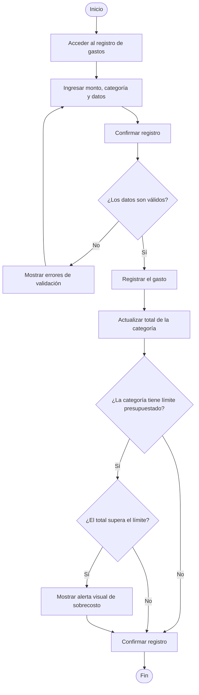

<!--
HOW TO USE THIS TEMPLATE
------------------------
1. Copy this file and rename it to the requirement's ID, e.g. REQ-01.md.
2. Fill in every section. If a section genuinely does not apply to this
   requirement (not every requirement has a Business Rule or a Constraint),
   write "N/A — none identified" and say why in one line. Never invent
   content to fill a blank cell — that breaks the rule we've followed since
   Class 8: specification is not invention.
3. If something is unknown rather than inapplicable, use the Open
   Questions section instead of guessing.
4. See REQ-07_Example.md (Food Delivery System) for a fully filled-in
   reference before you start.
-->

# REQ-02 — Registro de Gastos

| | |
|---|---|
| **Status** | Draft |
| **Team / Author(s)** | Kevin Daniel Flórez Hernández, David Esteban Sainea Rubio, Joger Ivan Muñoz Dueñas, Samuel Benítez Culma, Miguel Ángel Guativa Archila |
| **Date** | 2026-10-10 |
| **Linked User Story / AC** | US-02, AC-02.1, AC-02.2 | <!-- En relacion a las historias de usuario que estableceremos abajo -->

--- 

## 1. Overview

**Requirement Statement**
> El sistema debe permitir registrar un gasto capturando obligatoriamente: Monto (en COP), Fecha, Medio de Pago/Cuenta, Categoría y Tipo de Gasto (Necesidad, Deseo o Ahorro/Inversión/Deuda).

**Type:** Functional
*(Perfect Technology Filter: incluso si la tecnología funcionara a velocidad infinita, con memoria ilimitada y costo cero, el usuario aún necesitaría ingresar la información de las transacciones que realiza en su vida cotidiana para llevar el control de su dinero. El comportamiento de negocio no desaparece, por lo tanto es Funcional.)*

**Source / Evidence**
> Discovery Sheet, Necesidad Identificada Need-02: "El usuario necesita registrar un gasto hecho durante el día, siguiendo las recomendaciones de los expertos: que tenga tipo, categoría, monto, fecha y medio de pago."

**Need**
> Asociar cada salida diaria de dinero con sus atributos descriptivos clave (monto, fecha, fuente de pago, categoría y clasificación) para mantener la trazabilidad de los egresos.

**Value / Rationale**
> Permitir al usuario mantener un historial detallado y organizado de sus hábitos de consumo diarios, habilitando el control en tiempo real frente al presupuesto definido y la identificación de sobrecostos. <!-- Mismo SO THAT de la US -->
---

## 2. Context — A Requirement Rarely Stands Alone

**Business Rule(s)**
> BR-02: Un gasto podrá registrarse exitosamente aun cuando supere el límite presupuestado para su categoría. En estos casos, el sistema no impedirá la transacción, sino que generará una alerta visual de sobrecosto para apoyar la toma de decisiones del usuario.

> BR-04: El sistema proveerá una clasificación por defecto de categorías básicas de gasto (recomendada por expertos), pero otorgará la libertad al usuario de añadir nuevas categorías o eliminar existentes.

> BR-05: Todos los gastos categorías presupuestadas deben pertenecer, obligatoriamente, a uno de los siguientes tres tipos: Necesidad; Deseo; Ahorro, Inversión y/o Deuda.

**Constraint(s)**
> Todo ingreso de gasto nuevo deberá ser en Peso Colombiano (*BR-06*) 

**Assumption(s)**
> El usuario final hice un gasto real en peso colombiano que desea registrar, o en su defecto, hice la conversión del tipo de cambio antes del registro.

**Dependenc(ies)**
> Es necesario un presupuesto previamente diseñado y el usuario final debe estar autenticado en su sesión de usuario.

**Risk(s)**

| Risk | Likelihood | Impact | Mitigation (optional) |
|---|---|---|---|
| El usuario abandona el sistema porque registrar un gasto requiere de muchos pasos para hacerse | Medio-bajo | Alto | Diseñar el sistema de modo que el usuario registre un gasto con no más de tres clicks o toques de pantalla *(REQ-09)* |
| El usuario ingresa un gasto que sobrepasa el presupuesto realizado para la categoría y/o el presupuesto general | Alto | Medio | Continuar con el registro del gasto alertando al usuario final de los sobrecostos sobre el presupuesto planeado que el gasto implica *(BR-02)* |

**Open Questions**
> Está pendiente la discusión con el equipo sobre cómo mostrar los sobrecostos o sobregastos del usuario comparados con el presupuesto planeado, si aplica.

---

## 3. Priority & Estimation

**Priority model used:** MoSCoW / Kano / RICE / WSJF / Value-Effort *(pick the one that fits the decision you're actually making — see Class 10's comparison if you need to decide which)*

**Priority assigned:**

> **Priority model used:** RICE y MoSCoW

> **Priority assigned:** 5.3 (RICE) / Must-have (MoSCoW)  

> Dado que el objetivo principal de esta primera fase era establecer la lógica central necesaria para que nuestra aplicación funcionara, asignamos al requisito ***Registro de Gastos*** una puntuación **RICE de 5.3** y lo clasificamos como **Imprescindible (*Must-have*)** según el modelo **MoSCoW**. Aceptamos la contrapartida de posponer las funcionalidades más avanzadas para centrarnos primero en implementar las funcionalidades esenciales de la aplicación.

> Consideramos ***Registro de Ingresos*** y ***Gestión de Presupuesto Mensual*** como los siguientes requisitos en el orden de prioridad. Sin embargo, decidimos implementar ***Registro de Gastos*** primero, ya que proporciona una base para el desarrollo de los demás requisitos.

**Estimate (confidence):** High / Medium / Low
> **Estimate (confidance): 80% (High)**
> Asignamos un nivel de confianza del 80 % porque el requisito abarca una función central del sistema. Sin embargo, dado que la estimación aún no está respaldada por evidencia suficiente ni ha sido validada, debe considerarse una estimación provisional y no un resultado confirmado.

>| Name | Reach | Impact | Confidence (%) | Effort | MoSCoW | RICE Score |
>|---|---:|---:|---:|---:|---|---:|
>| Registro de gastos | 10 | 2 | 80 | 3 | Must | 5.33 |
>| Registro de Ingresos | 10 | 2 | 80 | 3 | Must | 5.33 |
>| Gestión de Presupuesto Mensual | 10 | 3 | 80 | 5 | Must | 4.80 |
>| Personalización de Categorías de Gasto | 7 | 2 | 80 | 3 | Should | 3.73 |
>| Análisis Comparativo y Visualización (Dashboard) | 10 | 2 | 80 | 6 | Should | 2.67 |
>| Gestión de Cuentas y Medios de Pago | 8 | 2 | 80 | 5 | Should | 2.56 |
>| Notificación / Alerta Visual de Sobrecosto | 7 | 1 | 70 | 3 | Should | 1.63 |

> *Notas:*
>
> *1. El plazo asignado para cada funcionalidad es de un mes después del lanzamiento de la aplicación.*
> *2. Los requisitos seleccionados se eligieron como base para el funcionamiento de la aplicación.*
> *3. El esfuerzo estimado se midió en días-persona, teniendo en cuenta el número de días laborables de un mes.*
> *4. El objetivo general de este conjunto de requisitos es garantizar que las funcionalidades principales de la aplicación funcionen correctamente.*
---

## 4. Representations — Requirement ≠ Representation

### 4.1 User Story

Historia de usuario 1 

> Como usuario de la aplicación, quiero registrar los gastos que realizo, para mantener un seguimiento actualizado de mi dinero.

Historia de usuario 2

> Como usuario de la aplicación, quiero recibir una alerta visual cuando mis gastos superen el presupuesto asignado a una categoría, para identificar los sobrecostos y tomar decisiones sobre mis finanzas.

Historia de usuario 3 

> Como usuario de la aplicación, quiero poder registrar un gasto aunque supere el presupuesto disponible de su categoría, para llevar un control real de mis gastos sin que la aplicación me impida registrar una transacción.

### 4.2 Acceptance Criteria

#### Historia de usuario 1 

**Escenario 1: Registro de un gasto dentro del presupuesto**

> **Dado** que el usuario tiene un presupuesto mensual configurado y una categoría disponible.
> **Cuando** registra un gasto válido cuyo monto acumulado no supera el límite de esa categoría.
> **Entonces** el sistema guarda el gasto y actualiza el total acumulado de la categoría.

**Escenario 2: Registro de un gasto que supera el presupuesto**

> **Dado** que el usuario tiene un presupuesto mensual configurado y una categoría cuyo límite está establecido.
> **Cuando** registra un gasto válido que hace que el total acumulado de esa categoría supere su límite.
> **Entonces** el sistema guarda el gasto, actualiza el total acumulado y muestra una alerta visual de sobrecosto.

#### Historia de usuario 2 

**Escenario 1: Se genera una alerta**

> **Dado** que una categoría tiene un límite presupuestado definido.
> **Cuando** el registro de un gasto hace que el total acumulado supere ese límite.
> **Entonces** el sistema muestra una alerta visual que informa que se ha excedido el presupuesto de la categoría.

**Escenario 2: No se supera el límite**

> **Dado** que una categoría tiene un límite presupuestado definido.
> **Cuando** el usuario registra un gasto y el total acumulado permanece dentro del límite.
> **Entonces** el sistema guarda el gasto sin mostrar una alerta de sobrecosto.

#### Historia de usuario 3 

**Escenario 1: El gasto supera el límite**

> **Dado** que los datos del gasto cumplen con las validaciones del sistema, pero su registro supera el presupuesto de la categoría.
> **Cuando** el usuario confirma la operación.
> **Entonces** el sistema permite registrar el gasto y muestra la alerta correspondiente, sin bloquear la transacción por el exceso presupuestario.

**Escenario 2: Los datos del gasto son inválidos**

> **Dado** que el usuario intenta registrar un gasto.
> **Cuando** los datos ingresados no cumplen con las reglas de validación del sistema.
> **Entonces** el sistema informa el error y solicita corregir los datos antes de guardar el gasto.

### 4.3 Use Case

| Field |  |
|---|---|
| **Use Case name** | Registro de gastos y control de sobrecostos |
| **Actor** | Usuario de la aplicación |
| **Goal** | Registrar los gastos realizados y conocer si superan el límite de su categoría presupuestaria. |
| **Trigger** | El usuario selecciona la opción para registrar un nuevo gasto. |
| **Precondition** | El usuario ha accedido a la aplicación y dispone de una categoría a la cual asociar el gasto. Para generar una alerta de sobrecosto, la categoría debe tener un límite presupuestario definido. |

#### Main Flow

1. El usuario accede a la sección de registro de gastos.
2. El sistema muestra el formulario para ingresar la información del gasto.
3. El usuario ingresa el monto, selecciona la categoría y completa los demás datos requeridos.
4. El usuario confirma el registro.
5. El sistema valida los datos ingresados.
6. Si los datos son válidos, el sistema registra el gasto.
7. El sistema actualiza el total acumulado de la categoría correspondiente.
8. El sistema compara el total acumulado con el límite presupuestado de la categoría.
9. Si el límite ha sido superado, el sistema muestra una alerta visual de sobrecosto.
10. El sistema confirma que el gasto fue registrado correctamente.

#### Alternative Flow

> El usuario registra un gasto válido, el sistema actualiza el total acumulado de la categoría, el sistema verifica que el total no supera el límite presupuestado, el sistema confirma el registro sin mostrar una alerta de sobrecosto.

#### Exception

> **Datos inválidos:** el sistema informa los errores y solicita corregirlos antes de guardar el gasto.
> 
> **Categoría sin límite presupuestario:** el sistema permite registrar el gasto, pero no puede determinar si existe un sobrecosto respecto a un límite que no está definido.
>
> **Error al guardar:** si ocurre un problema que impide guardar el gasto, el sistema informa que el registro no se completó y evita mostrarlo como una transacción registrada exitosamente.

#### Postcondition

El gasto queda registrado y el total acumulado de su categoría se actualiza. Si el total supera el límite presupuestado, el usuario recibe una alerta visual de sobrecosto. El exceso presupuestario no impide completar una transacción válida.

#### Flow Diagram

---

# 5. Traceability & Impact

## Backward Traceability — ¿Por qué existe este requisito?

**Evidencia (E-02):** Durante la exploración inicial de las prácticas de manejo de las finanzas personales, se identificó que algunas personas no llevan un registro organizado de sus gastos, mientras que otras calculan mentalmente cuánto pueden gastar o utilizan hojas de cálculo de excel. Además, identificamos que estos métodos pueden dificultar el seguimiento de los gastos y la consulta de la información cuando se necesita conocer en qué se ha utilizado el dinero.

Además, en la investigación documental se identificó la importancia de registrar los gastos indicando su monto, fecha, categoría y medio de pago o cuenta utilizada, para facilitar su organización y el seguimiento de los movimientos de dinero.

**Necesidad (N-02):** El usuario necesita registrar un gasto hecho durante el día o mes, siguiendo las recomendaciones de los expertos: que tenga tipo, categoría, monto, fecha y medio de pago.

**Requisito:** El sistema debe permitir registrar un gasto capturando obligatoriamente: monto en COP, fecha, medio de pago o cuenta, categoría y tipo de gasto: Necesidad, Deseo o Ahorro/Inversión/Deuda.

## Forward Traceability — ¿Qué elementos se verán afectados?

**Diseño futuro:**
- Un formulario para registrar gastos.
- Un campo para introducir el monto del gasto en COP.
- Un campo para la fecha.
- Listas de selección para el medio de pago o cuenta, la categoría y el tipo de gasto.
- Una vista para consultar los gastos registrados.

**Implementación:**
- Componentes del frontend para capturar y enviar la información del gasto.
- Operaciones del backend para validar y guardar los gastos.
- Estructuras en la base de datos para almacenar el monto, la fecha y las relaciones con la cuenta, la categoría y el tipo de gasto.
- Validaciones para impedir el registro de gastos sin los campos obligatorios, con montos inválidos o con referencias a cuentas y categorías inexistentes.

**Pruebas futuras:**
- Verificar que se pueda registrar un gasto cuando todos los campos obligatorios son válidos.
- Verificar que el sistema rechace el registro si falta alguno de los campos obligatorios.
- Verificar que se pueda seleccionar una fecha, un medio de pago o cuenta, una categoría y un tipo de gasto.
- Verificar que los datos guardados se conserven y se muestren correctamente al consultar el gasto.

Estos elementos son previsiones iniciales y deberán actualizarse cuando comience el diseño detallado y la implementación.

## Impact Analysis — ¿Qué más podría cambiar si este requisito se modifica?

- **Reglas de negocio:** Si cambian los campos obligatorios o la clasificación de los tipos de gasto, será necesario modificar las reglas de registro y clasificación de los movimientos.

- **Restricciones:** Cambiar la moneda permitida, la obligatoriedad de los campos o los formatos aceptados para el monto y la fecha afectaría las restricciones de validación para un gasto.

- **Dependencias:** El registro depende de que existan cuentas o medios de pago, categorías y tipos de gasto válidos. También puede relacionarse con los presupuestos mensuales y los informes financieros que utilicen los gastos registrados.

- **Riesgos:** Si se permiten registros incompletos o clasificaciones incorrectas, podrían generarse informes inexactos y dificultades para conocer en qué se gasta el dinero o desde qué cuenta se realizan los pagos.

- **Criterios de aceptación:** Los cambios en los campos obligatorios, los tipos de gasto o las reglas de validación requerirían revisar las condiciones necesarias para aceptar un registro.

- **Estimación:** Añadir campos, nuevas clasificaciones o validaciones más complejas podría aumentar el esfuerzo de desarrollo y pruebas, especialmente en términos de tiempo.

- **Prioridad:** La prioridad podría cambiar si se agregan funcionalidades adicionales al registro básico de gastos, especialmente si no son indispensables para la primera versión del sistema.

- **Diseño futuro:** Los cambios podrían afectar el formulario de registro, las listas de selección, la consulta de gastos y la adaptación de la interfaz a diferentes dispositivos.

- **Pruebas futuras:** Sería necesario actualizar los casos de prueba para cubrir los nuevos campos, las validaciones y las reglas de clasificación.

Se considerará que lo que más probabilidades tiene de cambiar son las restricciones, las reglas del negocio y las dependencias del requisito, y si eso cambia, se debería modificar los criterios de aceptación, la estimación del trabajo requerido, el diseño y las pruebas futuras.

---

## 6. Validation — Quality Gate

*(Class 9 + Class 10. Self-audit before you commit this file. Check honestly — a "no" here means the requirement isn't ready yet, not that you should force a checkmark.)*

- [ ] **Valid?** Does it reflect a real, evidenced need — not an invented one?
- [ ] **Clear / Unambiguous?** Is there only one reasonable interpretation?
- [ ] **Atomic?** Is this one independently testable expectation, not several bundled together?
- [ ] **Necessary?** Does removing it actually break something real?
- [ ] **Feasible?** Can this realistically be built with what the team has?
- [ ] **Verifiable?** Can you demonstrate, concretely, whether it's satisfied?
- [ ] **Consistent?** Does it conflict with any other requirement in your set?
- [ ] **Complete enough?** Are there important functions or constraints still missing?
- [ ] **Traceable?** Can every part of this document be traced back to real evidence — not invented to fill a section?

> If any box is unchecked, say what's missing and whether it becomes an Open Question or sends you back to Class 8 (re-elicit) or Class 9 (re-specify).
